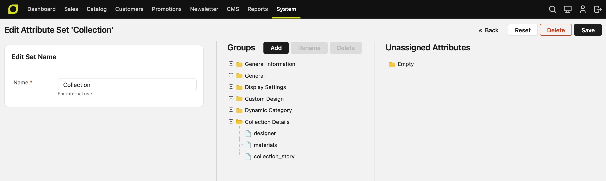
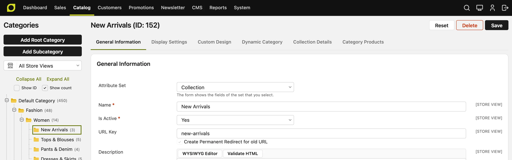
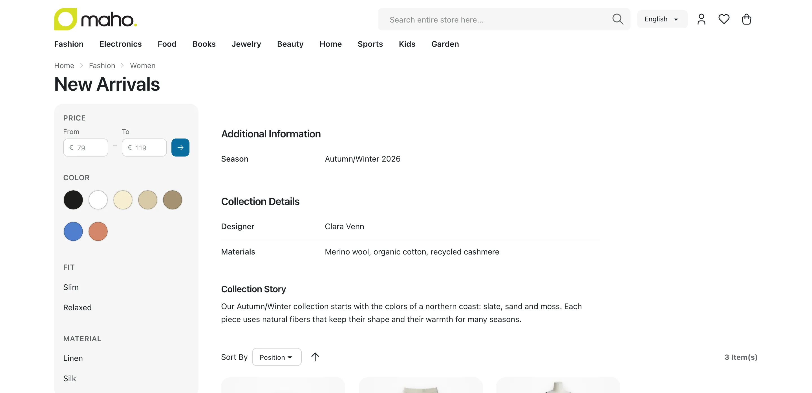

# Category Attributes and Attribute Sets

A category attribute is a field of a category, such as **Name** or **Description**. You can add
your own attributes, for example a brand story or a season. An attribute set is a list of
attributes in groups. Each group is a tab on the category page in the admin. Each category uses
one attribute set.

## Add an attribute

1. Go to **System > Attributes > Categories**.
2. Click **Add**.
3. On the **Properties** tab, enter the **Attribute Code**. Use only lowercase letters, numbers and
   underscores, and start with a letter. You cannot change the code later.
4. Select the **Input Type**: Text Field, Text Area, Date, Yes/No, Multiple Select, Dropdown or
   Image. You cannot change the input type later.
5. Select the **Scope**. **Store View** lets each store view have its own value. **Website** gives
   all the store views of a website one value, and each website can have its own value.
   **Global** gives all the websites one value.
6. On the **Manage Label / Options** tab, enter the label. For a Dropdown or a Multiple Select,
   add the options.
7. Click **Save**.

A new attribute goes into the first group of the **Default** set, so the category page shows it
at once. To move it to another tab or to add it to another set, edit the set.

You can delete only the attributes that you added. The standard attributes show **Yes** in the
**System** column of the grid.

## Put the attribute on a tab

1. Go to **System > Attributes > Categories** and click **Attribute Sets**.
2. Click the set, for example **Default**.
3. Drag the attribute from **Unassigned Attributes** to a group. To make a new tab, click **Add**
   above the groups.
4. Click **Save**.

The groups of the set are the tabs of the category page. A group with no attributes shows no tab.

## Use more than one set

Make a set for each kind of category. For example, a **Brand** set adds a logo and a brand story,
and the **Default** set does not show them.

1. Go to **System > Attributes > Categories**, click **Attribute Sets**, and click **Add**.
2. Enter the name, and select the set in **Based On**. The new set starts with the groups and the
   attributes of that set.
3. Click **Save**, then change the groups and the attributes.

When a store has more than one category set, the first tab of a category shows the
**Attribute Set** field. A new category starts with the set of its parent. When you select another
set, the page shows the fields of that set at once, and keeps the values that you entered.

You can also change the set of a saved category. When the new set does not have some attributes of
the old set, the page asks first and names them. When you save, the category loses its values of
these attributes.

Every night, the store deletes the value of an attribute that is not in the set of its category. So
the value of an attribute shows and stays only when the attribute is in the set.

You cannot delete the default set. When you delete another set, its categories move to the default
set.

## Show the attribute on the category page

Set **Visible on Category Page on Front-end** to **Yes** in the **Frontend Properties** of the
attribute. The category page then shows the attribute and its value in a table under the category
description. A category with no value for the attribute does not show it.

A **Text Area** value shows under the table, with the label of the attribute as its title, because a
long text does not fit in a table.

Each group of the set is a table of its own, in the order of the groups. The table of the first
group has the title **Additional Information**. Each other table has the name of its group, in the
language of the store view. In each table, the attributes follow the order of the group. To change
the order, drag the attribute in the set.

The table shows HTML only when **Allow HTML Tags on Frontend** or **Enable WYSIWYG** is **Yes**.
It does not show Image attributes.

## Translate the name of a group

The name of a group is the title of its tab in the admin, and the title of its table on the
category page. You can give the table a different title in each language.

1. On the set page, click the group, then click **Rename**. To make a new group, click **Add**.
2. In **Admin**, enter the name that the admin shows. Two groups of one set cannot have the same
   name.
3. In the row of each store view, enter the name in the language of that store view. If you leave a
   row empty, the store view shows the **Admin** name.
4. Click **Save** in the window, then click **Save** on the set page.

## The API

The categories of the REST and GraphQL API have two more fields. Only an admin and an API token can
read them:

- `attributeSetId`: the set of the category. A new category without one takes the set of its
  parent. An update can change the set, as for a product. The next night, the store deletes the
  values of the attributes that are not in the new set.
- `customAttributes`: the values of the attributes that you added, by attribute code. A write
  takes only the attributes of the set of the category. A Dropdown is an option ID, a Multiple
  Select a list of option IDs, and a Yes/No `true` or `false`. Only a
  read of one category by its ID and the response of a create or an update have this field. The
  list of categories, the children of a category and a read by URL key do not have it.

To find the attribute codes and the option IDs, read `GET /api/rest/v2/custom-attributes?entityType=catalog_category`.
