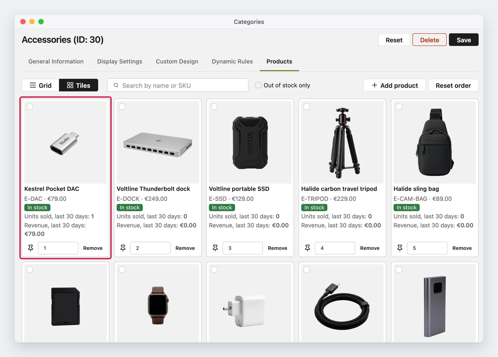
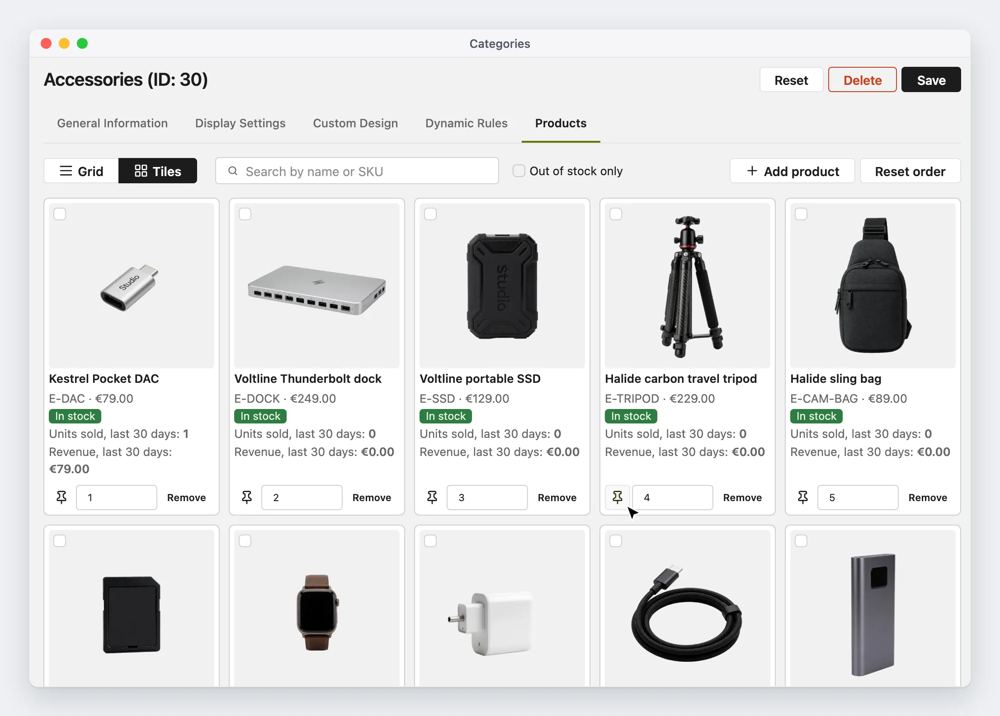
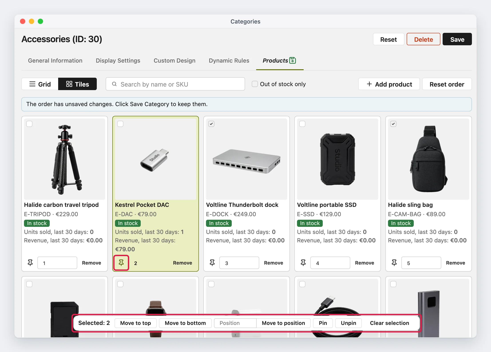
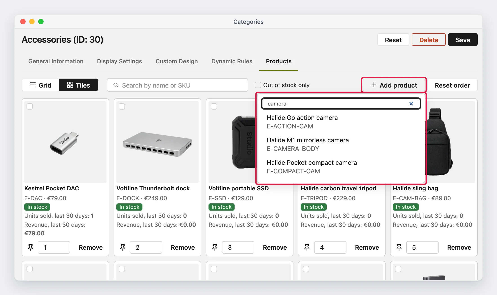
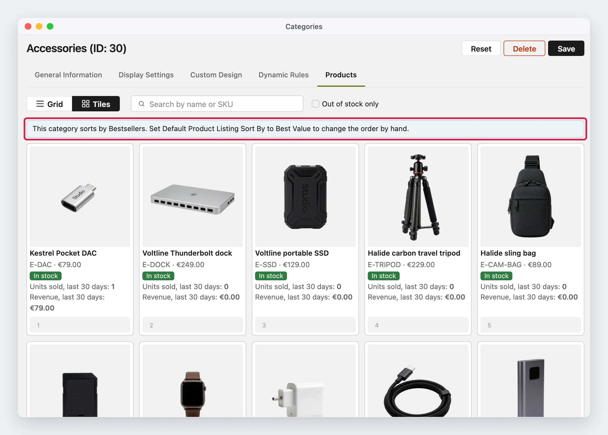
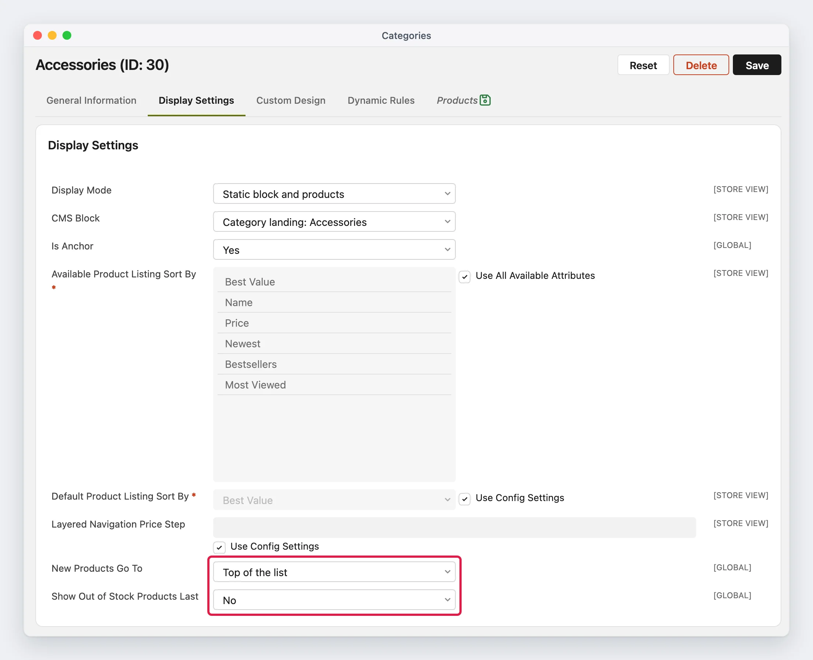
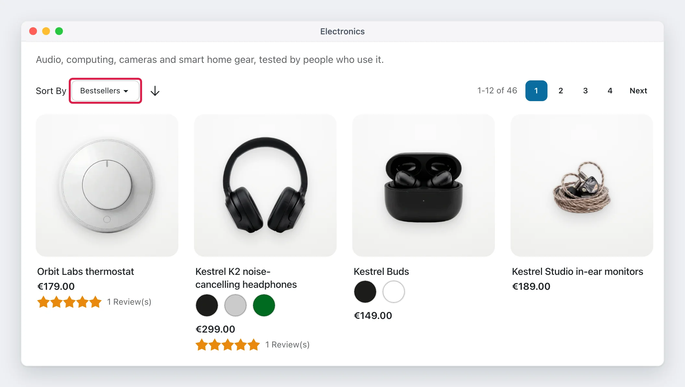
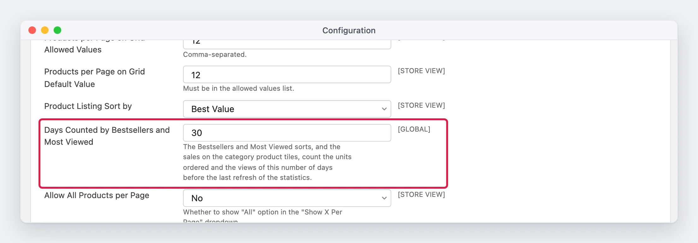
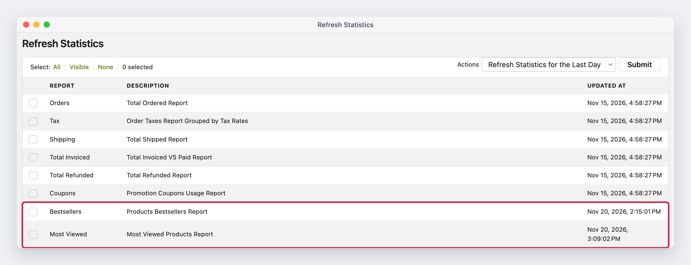

# Category Merchandising

Category merchandising decides which products a shopper sees first on a category page. Maho gives
you three tools:

- The visual merchandiser, a view of product tiles where you set the order with drag and drop, pins
  and bulk moves (see [Visual merchandiser](#visual-merchandiser)).
- The automatic sorts **Newest**, **Bestsellers** and **Most Viewed**, which keep the order up to date
  with no manual work (see [Automatic sorts](#automatic-sorts)).
- Two category settings: where new products go, and whether out of stock products show last.

The manual order works with positions. You give each product of a category a position on the
**Products** tab of the category. The storefront uses these positions only when the category page
sorts by **Position**. Another sort order, a sort order that the customer picked, or an index that
is not up to date can each hide your positions.

## Where you set the positions

Go to **Catalog > Categories**, select the category, and open the **Products**
tab. The **Position** column holds the position of each product in this category. A lower number
comes first when the direction is ascending, which is the default. Save the category.

The position belongs to the product in this category. The same product can have another position
in another category.

## Visual merchandiser

The visual merchandiser shows the products of the category as tiles, in the order of the storefront,
and you set the order with drag and drop. The **Tiles** button opens it, so this page also calls it
the tile view. The admin calls the position order
**Best Value**. The **Sort By** list of the storefront calls it **Position**.

To open the visual merchandiser:

1. Go to **Catalog > Categories** and select the category.
2. Open the **Products** tab.
3. Click **Tiles**. The browser remembers your choice for the next category.

Each tile shows:

- The image, the name, the SKU and the price of the product.
- The stock status, and a flag when the product is disabled or hidden.
- The units sold and the revenue of the last days. **Days Counted by Bestsellers and Most Viewed**
  sets the number of days (see [Statistics](#statistics)).
- The position of the product in the category.

The products that a dynamic category rule added show the badge **Added by a rule**.

## Change the order

When the category sorts by **Best Value**, you can change the order in four ways:

- Drag a tile to a new place.
- Type a number in the position field of a tile.
- Click the pin of a tile to keep it in its slot (see [Pinned products](#pinned-products)).
- Select tiles with their checkboxes and use the bar at the bottom of the screen.

The bar shows when you select at least one tile. It has these actions:

| Action | What it does |
|--------|--------------|
| Move to top | Moves the selected products to the first slots |
| Move to bottom | Moves the selected products to the last slots |
| Move to position | Moves the selected products to the position that you type in the field before it |
| Pin | Pins the selected products in their slots |
| Unpin | Removes the pin of the selected products |
| Clear selection | Clears the checkboxes and hides the bar |

A dashed line between the tiles marks the end of each storefront page, counted by position. The line
uses the number of products per page of the store. A product that the storefront hides, or an out of
stock product that the storefront shows last, can move the real end of a page.

The tiles load 100 at a time when you scroll. **Move to position** also reaches a slot that the page
did not load yet.

## Find, add and remove products

- Type in **Search by name or SKU** to show only the matching tiles.
- Tick **Out of stock only** to show only the products that are out of stock.

While a search or a filter is on, you cannot drag the tiles. The actions of the bar still work.

To add a product:

1. Click **Add product**.
2. Type a part of the name or of the SKU.
3. Click the product in the list. The tile shows at the top or at the bottom of the list, as
   **New Products Go To** sets.

To remove a product, click **Remove** on its tile. A dynamic category offers neither **Add product**
nor **Remove**, because its rules decide which products it holds.

## Save or discard the changes

Your changes stay in the page until you click **Save Category**. While the order has unsaved
changes, a line above the tiles says so, and the **Products** tab shows the mark of a changed tab.
**Reset order** discards the changes that you did not save.

The grid and the tile view change the same list, so you can use both before you save. When you select
another category or store view with unsaved changes, the page asks you first.

The order that you set is the same in all store views. The tile view says so when you select a store
view.

## When the tiles are read-only

When the category sorts by something else than Best Value, the tiles are read-only and show the
order of the storefront. A line above them names the sort order of the category and says what to
change. The store uses the value of the store view that you selected at the top of the page, with
**Use Config Settings** included. With **All Store Views**, the Bestsellers and Most Viewed sorts
count the sales and the views of all store views. Select a store view to see its own order.

A sort order that is not Best Value never changes the positions. The manual order comes back when you
set the sort order to Best Value again.

## Pinned products

Pin a product to keep it in its slot. The other products move around the pinned slots: when a
product enters the category, leaves it, or moves in the list, a pinned product stays at the same
position number. A pinned tile has a colored background, and its position number is fixed. You
cannot drag it, and it does not move when you drag other tiles. Unpin it to move it again. Pins work
only in the manual order.

## Where new products go

**New Products Go To** on the **Display Settings** tab of the category sets where a product that
enters the category goes: to the **Top of the list** (the default) or to the **Bottom of the list**.
It applies to the products that a dynamic category rule adds, to the products that you tick in the
grid without a position, and to the products that you add in the tile view. When you type a
position for a product, the store keeps your position.

## Out of stock products last

Set **Show Out of Stock Products Last** to Yes on the **Display Settings** tab to put the products
that are out of stock after the products that are in stock, with every sort order. The store sorts
by stock status first, and then by the sort order of the category. It never changes the positions,
so a product goes back to its slot when it is in stock again. This rule is stronger than a pin. It
matters only when the store shows out of stock products
(**System > Configuration > Inventory > Stock Options**). The tile view shows a line when the setting
is on.

## Automatic sorts

The sort lists of the category and of the storefront offer three more sort orders:

| Sort order | The store sorts by |
|------------|--------------------|
| Newest | The date when the product was created. The newest product comes first |
| Bestsellers | The units that the product sold in the last days. The highest number comes first |
| Most Viewed | The views of the product page in the last days. The highest number comes first. It needs the Reports module and the settings **Enable Reports** and **Enable Recently Viewed Products**, because the store records the views only then |

A product with no sales, or no views, in the period comes last, in both directions. The shopper can
reverse the direction with the arrow next to **Sort By**.

### Statistics

The number of days is **Days Counted by Bestsellers and Most Viewed** in
**System > Configuration > Catalog > Catalog**, group **Frontend**. The default is 30. The period is
the last days before the last refresh of the statistics, not a calendar month. The store counts the
orders of every state except Canceled.

The statistics refresh with the daily jobs of the reports, at midnight by default
(**System > Configuration > Reports > Cron Settings**). To refresh them now:

1. Go to **Reports > Statistics > Refresh Statistics**.
2. Tick **Bestsellers**, **Most Viewed**, or both.
3. In **Actions**, select **Refresh Statistics for the Last Day** or **Refresh Lifetime Statistics**,
   and click **Submit**.

After you change the number of days, the new period starts at the next refresh. The tile view shows
when the statistics were updated last.

## Which sort order the category page uses

The category page takes the first sort order that applies, in this order:

1. The sort order that the customer picks in the **Sort By** list of the category page.
2. The sort order that the customer picked before. The store remembers it in the session of the
   customer, also on the next category pages, until the customer picks the default sort order of a
   category again.
3. **Default Product Listing Sort By** on the **Display Settings** tab of the category, when it is
   one of the sort orders that the category offers.
4. **Product Listing Sort by** in **System > Configuration > Catalog > Catalog**, group
   **Frontend**. Its default is Position.
5. The first sort order that the category offers.

So your positions show only when the result is **Position**.

The direction counts too. The arrow next to the **Sort By** list changes it, and the store
remembers the direction that the customer picked in the same way as the sort order. With the
descending direction, the highest position comes first.

## Sort settings of a category

On the **Display Settings** tab of the category:

| Field | What it does |
|-------|--------------|
| Available Product Listing Sort By | The sort orders that the **Sort By** list of the category offers. With **Use All Available Attributes**, it offers every attribute that is used for sorting |
| Default Product Listing Sort By | The sort order of the category page before the customer picks one. With **Use Config Settings**, it is the value of **Product Listing Sort by** in the configuration |

Both fields have the scope **[STORE VIEW]**: a store view can have its own value (see
[Scope](scope.md)). If **Default Product Listing Sort By** is not in the available sort orders of
the category, the store uses the configuration value instead.

## Anchor categories

When **Is Anchor** is Yes, the category page also shows the products of its subcategories. The
products of the category itself come first, by their positions. The products of the subcategories
come after them. For each of these products, the store calculates a sort number from the position
and the level of its subcategory, and from the position of the product in that subcategory. With
positions below 10000, the products of one subcategory stay together, and among the subcategories
of one level, a lower position comes first. A subcategory on a deeper level can come before a
subcategory on a higher level. To move a product of a subcategory to the top, assign the product to
the anchor category too, and give it a position there.

## Equal positions

Products with the same position, for example 0 for every product, are sorted by their product ID.
Give each product its own position when the order matters.

## Category Products index

Category pages read the positions from the **Category Products** index, not from the category
directly. In **Update on Save** mode, the store updates the index when you save the category. In
**Manual Update** mode, the category page keeps the old order until someone reindexes it in
**System > Index Management**.

## Search results

Search results do not use the positions of a category. They sort by **Relevance** by default.

## Troubleshooting

| What you see | Why | What to do |
|--------------|-----|------------|
| The category ignores your positions | **Default Product Listing Sort By** of the category, or **Product Listing Sort by** in the configuration, is Name or Price | Set the category, or the configuration, to Position |
| You see another order than your customers | You picked a sort order in the **Sort By** list before, and the store remembers it for your session | Pick the default sort order again, or open the page in a private window |
| The products show in the reverse order | The direction is descending: someone clicked the arrow next to **Sort By**, and the store remembers it for that session | Click the arrow again, or open the page in a private window |
| One store view shows another order | That store view has its own value of the sort settings of the category | Select the store view and check **Use Config Settings** and the value |
| The products of a subcategory are always at the end | The category is an anchor category, and those products are not in the category itself | Assign the products to the category and give them a position |
| The tiles are read-only | The category sorts by something else than Best Value | Add Best Value to **Available Product Listing Sort By** when it is missing, set **Default Product Listing Sort By** to Best Value, and save the category |
| Bestsellers or Most Viewed shows no order | The statistics have no rows yet, or are old | Refresh the statistics in **Reports > Statistics > Refresh Statistics** |
| The new positions do not show | The **Category Products** index is in **Manual Update** mode, or needs a reindex | Reindex in **System > Index Management** |
| Products with the same position change places | Products with equal positions are sorted by product ID | Give each product its own position |

## Related

- [Scope](scope.md) for values per store view.
- [URL rewrites](url-rewrites.md) for the URLs of categories.
