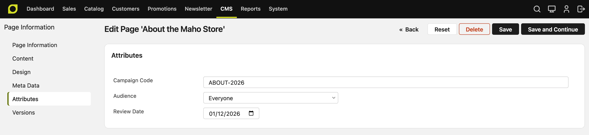
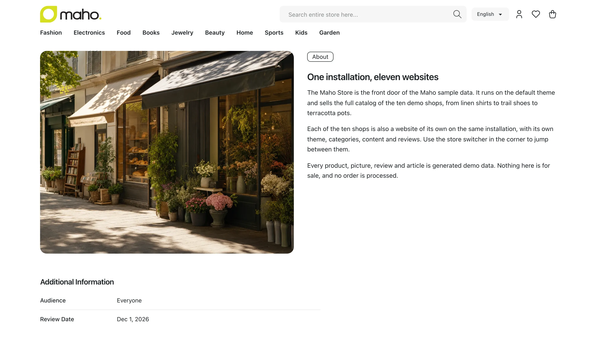

# CMS Page Attributes v27.1+

A page attribute is a field that you add to every CMS page, for example a campaign code, an
audience or a review date. The standard fields, such as **Title** and **Content**, are not page
attributes. All the CMS pages use one attribute set. The groups of the set give the order of the
fields, the tabs of a page in the admin and the tables on the storefront.

## Add an attribute

1. Go to **System > Attributes > CMS Pages**.
2. Click **Add**.
3. Enter the **Attribute Code**. Use only lowercase letters, numbers and underscores, and start
   with a letter. You cannot change the code later.
4. Select the **Input Type**: Text Field, Text Area, Date, Yes/No, Multiple Select or Dropdown. You
   cannot change the input type later.
5. Set **Values Required** to **Yes** if each page must have a value. Set **Unique Value** to
   **Yes** if two pages cannot have the same value.
6. To show the value on the page, set **Visible on Frontend** to **Yes** in **Frontend
   Properties**.
7. On the **Manage Label / Options** tab, enter the label. For a Dropdown or a Multiple Select,
   add the options.
8. Click **Save**.

The code cannot be the name of a standard field, such as `title`, `identifier` or `content`. It also cannot be `stores` or `store_id`.

A new attribute goes into the first group of the set, so every page shows it at once.

## Order and group the attributes

1. Go to **System > Attributes > CMS Pages** and click **Attribute Set**.
2. Drag the attributes to change their order. To make a new group, click **Add** above the groups.
3. Click **Save**.

To hide an attribute on all the pages, drag it to **Unassigned Attributes**, and click **Save**. The
page asks first. The pages keep their values, and show them again when you put the attribute back
in the set.

To give a group a title in each language, click the group, then click **Rename**. In the row of each
store view, enter the name in the language of that store view. A row that you leave empty shows the
**Admin** name.

## Fill in the attribute

Go to **CMS > Pages** and open a page. The **Page Information** tab shows the attributes of the
first group of the set, under the standard fields. Each other group that holds an attribute is a
tab of its own, with the name of the group.

A new page gets the **Default Value** of each attribute. A page attribute has one value for all the
store views of the page. A store with more than one language usually has one page for each store
view, so each language gets its own value.

## Delete an attribute

You can delete a page attribute on its edit page. The store deletes the attribute and the values
of all the pages for it. You cannot undo this.

If you add an attribute with the same code again, the pages have no value for it.

## Show a field only when another field has a value

A condition shows a field only when other fields of the same form have some values. For example, a
field **Campaign End** can show only when the **Layout** is a landing page layout.

1. Open the attribute in **System > Attributes > CMS Pages**.
2. Go to the **When the Field Shows** section.
3. Click **Add**, then select the field that decides and the values that show the field. Hold the
   Ctrl or Cmd key to select more than one value.
4. For more than one row, select in **Show the field when** if each row, at least one row, no row
   or exactly one row must match.
5. Click **Save**.

A condition can read only a field with a list of values, such as a **Dropdown**, a **Yes/No** field,
the **Status** or the **Layout** of the page. A field that a condition reads cannot have a condition
of its own, and you cannot delete it while a condition reads it.

When the condition hides a field, the edit page does not show it, the field is not required, and a
save deletes its value. The API applies the same rule. A field on another tab reads the saved value
of the field that decides, not the value that you just changed. Save the page to update it.

## Show a value on the storefront

Set **Visible on Frontend** to **Yes** in the **Frontend Properties** of the attribute. The page
then shows the attribute and its value in a table below its content. A page with no value for the
attribute does not show it.

Each group of the set is a table of its own, in the order of the groups. The table of the first
group has the title **Additional Information**. Each other table has the name of its group, in the
language of the store view. In each table, the attributes follow the order of the group.

A **Text Area** value shows under the table, with the label of the attribute as its title, because a
long text does not fit in a table.

Set **Allow HTML Tags on Frontend** to **Yes** to keep the HTML of a value. The store removes unsafe
HTML, such as a script. It also removes codes in braces, such as `{{store url=""}}`. With **No**,
the page shows the tags as text.

A theme can also show a value in another place of the page. The
[attribute admin pages](../developer/eav-attribute-admin.md#the-storefront-table) page tells a
developer how.

## Import

The CMS page import file can have a column for each page attribute, with the code of the attribute
as its name. A Dropdown or a Multiple Select takes the labels of the options. Separate more than
one label with commas. An empty cell keeps the value that the page has. An import refuses a value
for an attribute that is not in the set.

## The API

The CMS pages of the REST and GraphQL API have the `customAttributes` field: the values of the page
attributes in the set, by code. Only an admin and an API token can read and write it. A Dropdown is the
option ID, a Multiple Select a list of option IDs, and a Yes/No `true` or `false`.

`GET /api/rest/v2/custom-attributes?entityType=cms_page` lists the attributes and their options.
