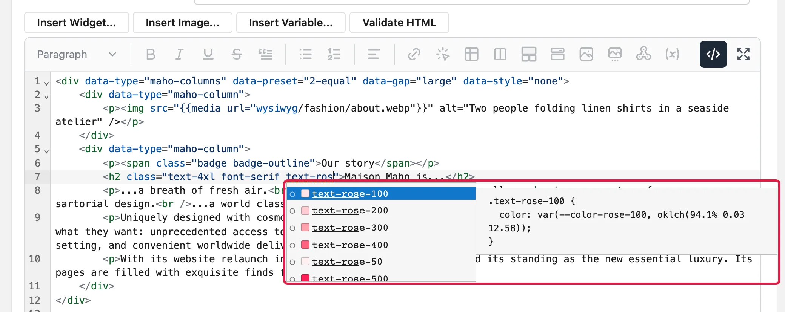
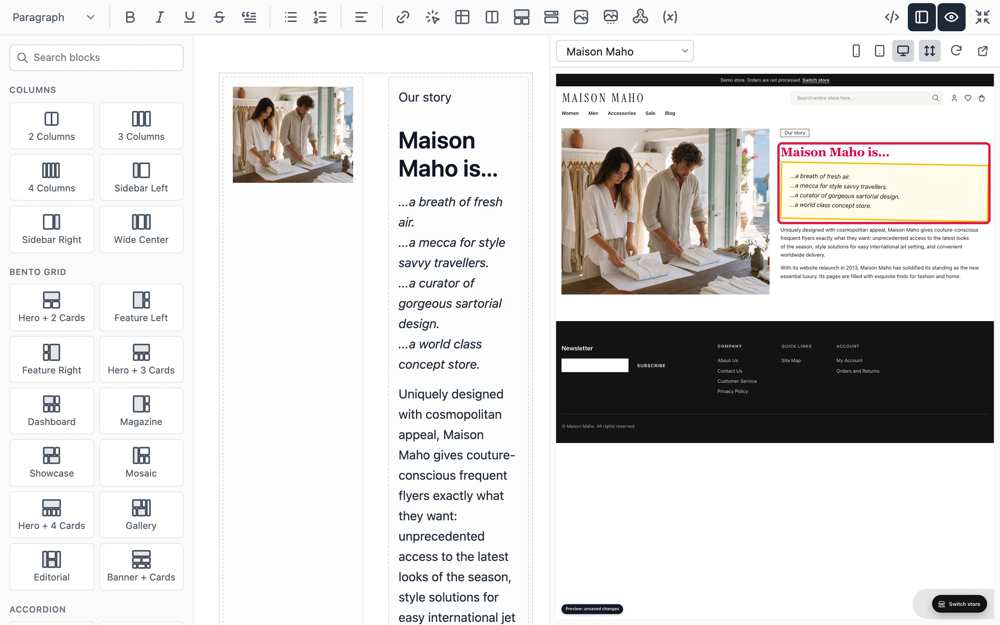

# HTML and Tailwind Classes in Content

The content editor shows rich text. The **source view** shows the HTML of the same content in a
code editor. Use the source view to give an element a `class`, or to change HTML that the rich text
editor does not show.

The storefront is built on Tailwind CSS and daisyUI. So a class such as `text-rose-600`,
`rounded-box` or `md:text-center` styles the content, as it does in the templates of the theme.

## Open the source view

Click **Source** (the `</>` button) in the toolbar of the content editor. Click it again to go back
to the rich text. The button is also in the toolbar of **Fullscreen Page Builder**.

When you go back to the rich text, the editor checks the HTML. If the rich text editor cannot keep
a part of it, a message names that part and asks before the editor removes it.

In the source view, these buttons show under the field. They insert at the cursor of the code
editor:

| Button | What it inserts |
|--------|-----------------|
| Insert Widget... | A `{{widget}}` directive |
| Insert Image... | An image from the media library |
| Insert Variable... | A store or custom variable, such as `{{config path="general/store_information/name"}}` |
| Validate HTML | Nothing. It checks the HTML with the W3C validator and lists the errors |

The setting **Enable WYSIWYG Editor** in **System > Configuration > Content Management > WYSIWYG
Options** decides how a field opens:

| Value | The field opens in |
|-------|--------------------|
| Enabled by Default | The rich text |
| Disabled by Default | The source view. Click **Source** for the rich text |
| Disabled Completely | A plain text field, with no editor |

The **Show / Hide Editor** button under the field no longer exists. The **Source** button does the
same thing.

## Edit the HTML of one element

You can open the HTML of one element only, instead of the whole content:

- A **Columns**, **Bento Grid** or **Accordion** block, and each of its cells, has a badge when the
  pointer is on it. Click the `</>` button of the badge.
- In the popup menu of a table, click **Edit HTML**.
- Click the label of a `div` element, or double-click an element that the rich text editor cannot
  edit, such as a video.

The **Edit HTML** dialog shows the HTML of that element. Click **Update** to replace the element.
Undo (Ctrl+Z, or Cmd+Z on a Mac) brings back the element as it was, in one step.

## Use classes

Inside a `class` attribute, the code editor helps you with the classes of the store view:

- **Completion.** Type the start of a class. The list shows the classes that the storefront knows,
  also variants such as `md:` or `hover:`. A color class has a square in its color. The panel next
  to the list shows the CSS of the selected class.
- **Tooltip.** Point at a class to see its CSS. When the classes of the attribute are not in the
  order that Tailwind recommends, the tooltip has a **Sort the classes** button.
- **Unknown class.** A class that the storefront does not style gets a wavy underline and the
  message "No style found for the class". Check the spelling. A daisyUI class that the theme does
  not use yet also gets this message, but it works on the storefront after the save.
- **Shorter form.** When a class has a shorter name, such as `h-full` for `h-[100%]`, the editor
  shows a hint. Click **Replace** in the hint to use the shorter name.

The editor uses the theme and the colors of one store view: the store view of the page or the
block, or the default store view when the content shows in all store views. In
**Fullscreen Page Builder**, the store view of the preview applies.

## When a new class shows on the storefront

The **Preview** pane of **Fullscreen Page Builder** shows a new class at once, before you save.

The storefront shows a new class after the save, when the store has built a new stylesheet:

1. You save the content.
2. About one minute later, the store builds a stylesheet with the classes of all the content.
3. The storefront loads the new stylesheet.

An import of products, categories or CMS content also starts a build when it ends.

The build needs Node.js on the server, and a queue worker that runs it. Without them, the storefront
shows only the classes that the theme already has, and a new class has no effect there. Ask the
person who runs your server, and see [Tailwind build of the content](../hosting/tailwind-content-build.md).

The classes work in this content:

| Content | Where to edit it |
|---------|------------------|
| CMS pages and static blocks | **CMS > Pages**, **CMS > Static Blocks** |
| Blog posts | **CMS > Blog > Posts** |
| Widgets | **CMS > Widgets** |
| Custom variables | **System > Custom Variables** |
| Terms and conditions of the checkout | **Sales > Terms and Conditions** |
| Product and category descriptions | Each text attribute that has the WYSIWYG editor |
| **Copyright** and **Miscellaneous HTML** of the footer, **Demo Store Notice Text** | **System > Configuration > Design** |

The preview cannot show a daisyUI class that the theme does not use yet, such as a component class.
The storefront shows it after the build.
