# Image Editor v26.5+

The image editor changes the images of the media library without a second application. It has nine
tools: Crop, Resize, Transform, Adjust, Annotate, Redact, Frame, Remove BG and Upscale.

!!! info "Your images stay on your computer"
    The editor and all its tools run in your browser, on your computer. This includes the two AI
    tools, Remove BG and Upscale. Maho sends no image to a cloud service, to an AI provider or to
    any other third party. There is no account to make, no API key and no cost for each image. The
    image goes to one place only: your own store, when you click **Save**.

The editor is for the daily work on product and content images. For example, use it to:

- make a small supplier photo larger and sharper
- put a product on a white background
- correct a photo that is too dark, too yellow or too flat
- give all the photos of a category the same shape and the same look
- hide a name, an address or a face before you publish a photo

## Open the image editor

1. Go to **CMS > Media Library**.
2. Select the folder of the image.
3. Click the image.
4. Click **Edit Image**.

You can also double-click the image.

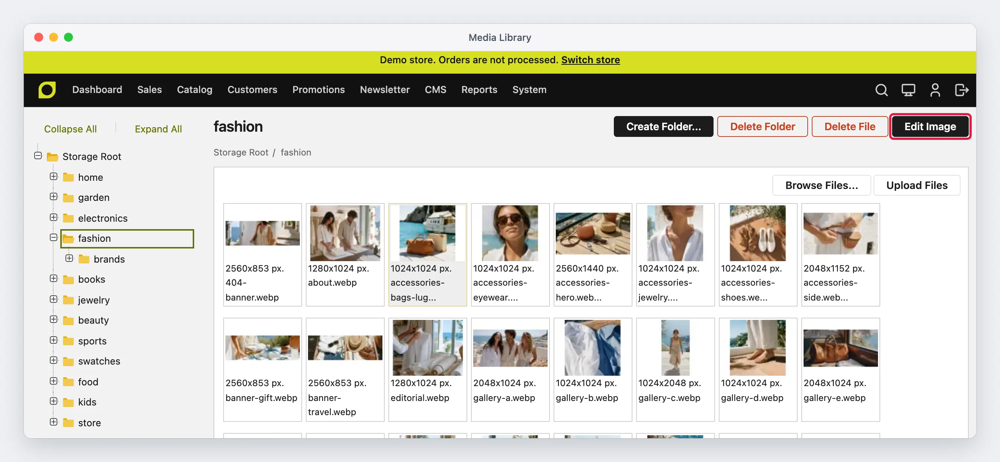

**Edit Image** shows only for an image, and only in **CMS > Media Library**. The **Insert Image**
dialog of the content editor does not open the editor: there, a double-click inserts the image.

## The editor screen

The editor has four areas:

- **The header** shows the file name, **Undo**, **Redo**, the zoom controls and **Save**. The
  **X** at the left closes the editor.
- **The tool bar** at the left has one button for each tool. Click a tool to open it. Click it
  again to close it.
- **The photo** is in the middle. A checkered pattern shows the transparent areas.
- **The options panel** at the right shows the options of the open tool. The Adjust tool also shows
  its filters in a strip under the photo.

On a screen narrower than 1100 px, the options panel goes under the photo.

### Zoom and move the photo

The zoom percentage is relative to the photo that fits the view. So 100% shows the full photo, not
one screen pixel for each image pixel. Click the percentage, or the fit button next to **+**, to
fit the photo in the view again.

| Action | Mouse or keyboard |
|--------|-------------------|
| Zoom in | **+**, or Ctrl+= (Cmd+= on a Mac) |
| Zoom out | **−**, or Ctrl+- (Cmd+-) |
| Fit the photo in the view | Click the percentage, or Ctrl+0 (Cmd+0) |
| Show the real pixels | Ctrl+1 (Cmd+1) |
| Move the photo | Hold Space and drag, or drag with the middle mouse button |
| Undo | **Undo**, or Ctrl+Z (Cmd+Z) |
| Redo | **Redo**, or Ctrl+Shift+Z (Cmd+Shift+Z) |
| Apply a crop or a resize | Enter |
| Delete the selected annotation | Delete or Backspace |
| Close the editor | **X**, or Escape |

### Undo and redo

**Undo** goes back one step, and the editor keeps the last 30 steps. One drag of a slider is one
step. An upscale and a background removal are also one step each, so **Undo** always returns the
original image.

If you close the editor with changes that are not saved, the editor asks before it closes.

## How the editor keeps your changes

The tools work in two different ways:

- **Crop, Resize, Transform, Remove BG and Upscale** change the pixels of the image at once.
- **Adjust, Annotate, Redact and Frame** stay separate from the image until you save. You can
  change or remove them at any time. Their result goes into the file when you click **Save**.

So the order of your work is free. For example, you can set the Adjust sliders first and crop
later: the adjustments then apply to the cropped image. A crop moves the annotations and the
redacted areas with the image, and a resize scales them with it.

## Adjust

Adjust corrects the light and the colors of the photo, and applies a filter.

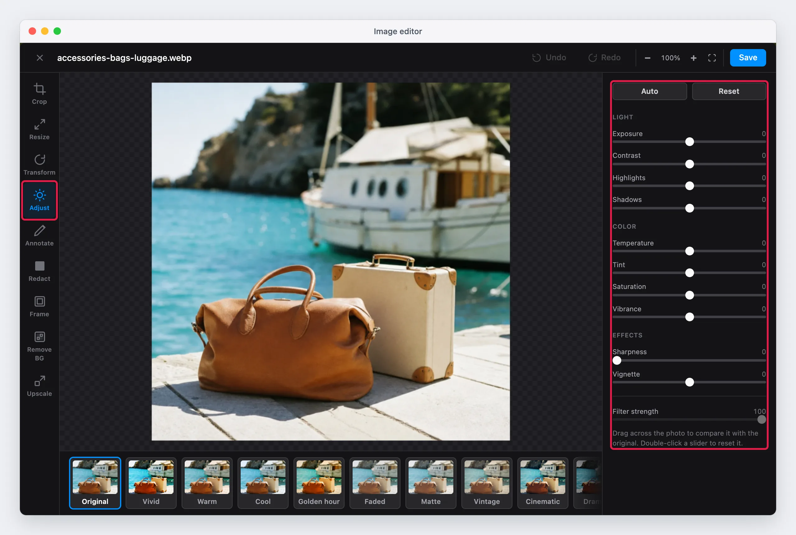

### Correct a photo in one click

Click **Auto**. The editor reads the light and the colors of the photo, and sets the sliders:

- It changes **Exposure** only when the photo is too dark or too bright. A product on a white
  background keeps its white background.
- It sets **Contrast**, **Shadows** and **Highlights** from the range of the light in the photo.
- It corrects the white balance from the areas that are nearly gray. A product with a strong color
  does not change the correction. The correction is half of the full value, because a guess from
  the gray areas can be wrong.
- It adds a small amount of **Vibrance** and **Sharpness**.

Then move the sliders to fine-tune the result. **Auto** does not change the filter.

### The sliders

Each slider starts at 0. Double-click a slider to set it back to 0. **Reset** sets all the sliders
back to 0 and removes the filter.

| Group | Slider | What it does |
|-------|--------|--------------|
| Light | **Exposure** | Makes the full photo brighter or darker, as the exposure of a camera does. |
| Light | **Contrast** | A positive value makes the dark areas darker and the bright areas brighter. Pure black and pure white stay as they are, so no detail turns pure black. A negative value makes the photo flatter. |
| Light | **Highlights** | Changes only the bright areas. A negative value brings back the detail of a bright sky or a white product. |
| Light | **Shadows** | Changes only the dark areas. A positive value shows the detail in the dark areas. |
| Color | **Temperature** | Sets the white balance. A negative value makes the photo cooler (more blue). A positive value makes it warmer (more yellow). |
| Color | **Tint** | Corrects a green or a magenta cast. A negative value adds green. A positive value adds magenta. |
| Color | **Saturation** | Makes all the colors stronger or weaker. At -100, the photo is black and white. |
| Color | **Vibrance** | Makes the weak colors stronger, and changes the strong colors less. Use it to give a flat photo more color without too much color on the product. |
| Effects | **Sharpness** | Makes the edges sharper. It changes only the brightness, so the edges get no color fringes. |
| Effects | **Vignette** | A positive value makes the corners darker. A negative value makes the corners lighter. |

Exposure and white balance work on the light values of the photo, as a camera does. So a warmer
photo is not only more yellow: its whites become really warm, and its grays keep their brightness.

### Filters

The filters are in the strip under the photo. Each filter shows a preview of the center of your
photo. Click a filter to apply it. Click **Original** to remove it.

| Filter | Look |
|--------|------|
| **Vivid** | More contrast, stronger colors and sharper edges |
| **Warm** | A warmer white balance |
| **Cool** | A cooler white balance |
| **Golden hour** | Warm light of the evening, with softer highlights and darker corners |
| **Faded** | Less contrast, lighter blacks and weaker colors |
| **Matte** | Soft and flat, with lighter shadows that have a blue tone |
| **Vintage** | Weaker and warmer colors, darker corners and a color tone of an old print |
| **Cinematic** | Strong contrast, blue shadows and orange highlights, as in a film |
| **Dramatic** | Very strong contrast, dark shadows, sharp edges and dark corners |
| **Mono** | Black and white |
| **Noir** | Black and white, with very strong contrast and dark corners |
| **Sepia** | Black and white with a warm brown tone |

A filter adds its values to the sliders. The sliders show only your own values, so you can use a
filter and the sliders together. For example, apply **Golden hour** and then set **Exposure** to
+10.

**Filter strength** sets how much of the filter applies, from 0 to 100. A new filter always starts
at 100.

### Compare with the original

Drag across the photo while Adjust is open. A line follows the pointer. The original photo shows
left of the line, and the adjusted photo shows right of it. Release the mouse button to see the
full adjusted photo again.

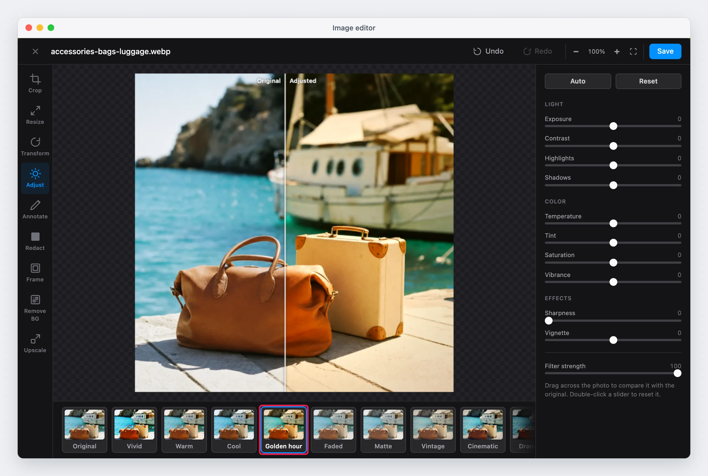

The compare line shows only when the photo has an adjustment or a filter.

## Upscale v26.11+ { #upscale }

Upscale makes a photo 2 or 4 times larger with an AI model. The model draws new detail, so the
result is much sharper than a resize. Use it for a small photo from a supplier, or for an old photo
that is too small for a zoom on the product page. The model runs in your browser, so the photo
stays on your computer.

1. Click **Upscale** in the tool bar.
2. Select a **Scale**: 2× or 4×. The line under it shows the size before and after.
3. Click **Upscale**.

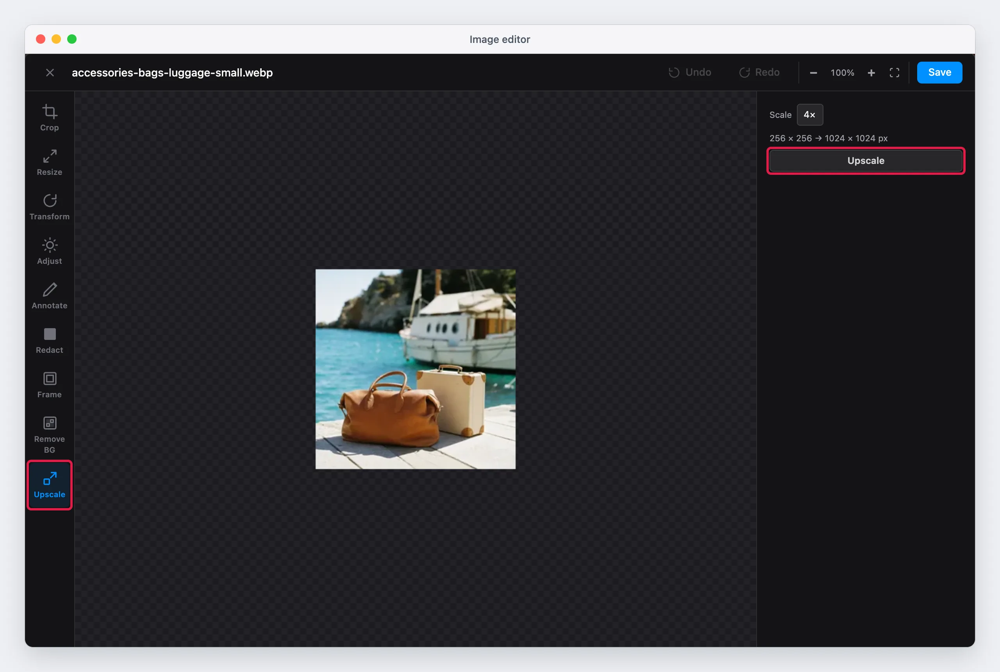

The editor cuts the photo into tiles and upscales one tile after the other. The status shows the
tile that the editor works on. To stop, click **Cancel**. The image then stays as it was.

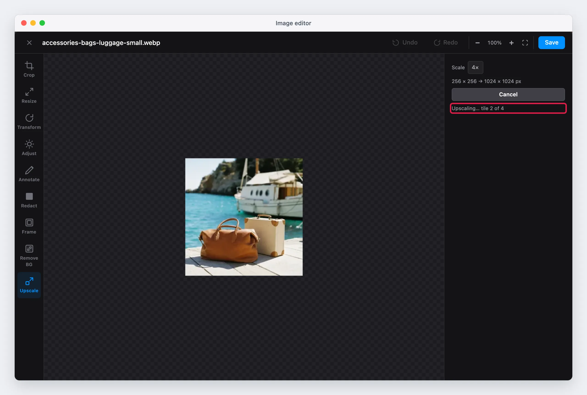

The result replaces the image. **Undo** returns the original.

Upscale accepts an image of up to 1024 px on its longest side, so the result is at most 4096 px.
For a larger image, the **Upscale** button is not available. Crop or resize the image first.

A transparent background stays transparent after the upscale.

!!! warning "Check small text after an upscale"
    The model draws new detail. It can change small letters, for example the text on a label or on
    a package. Zoom in to check the result before you save. If the text changed, click **Undo**.

The time of an upscale depends on the computer. As an example, one tile takes about 4 seconds on a
computer with WebGPU, and about 14 seconds without it. A photo of 500 × 500 px has 9 tiles. See
[The AI tools](#the-ai-tools) for the first use.

## Remove BG

Remove BG removes the background of a photo with an AI model. The product stays, and the background
becomes transparent. The model runs in your browser, so the photo stays on your computer.

1. Click **Remove BG** in the tool bar.
2. Click **Remove Background**.
3. Wait until the status shows "Background removed".

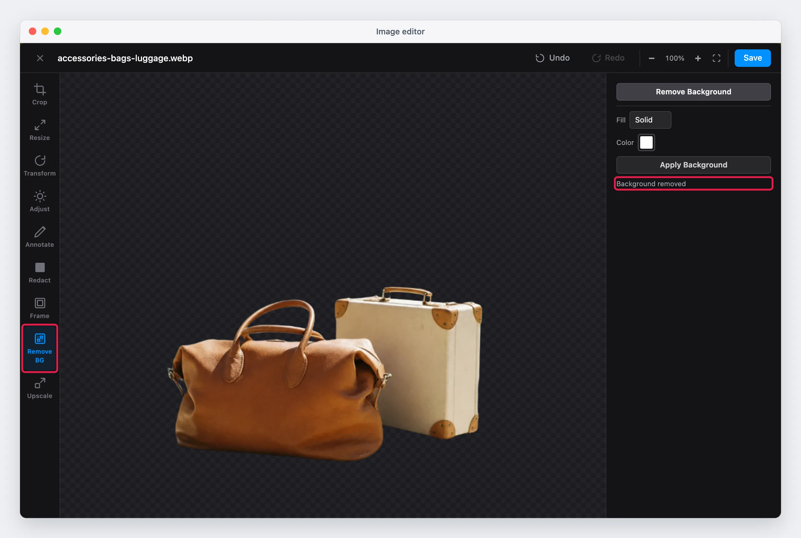

To put the product on a new background:

1. In **Fill**, select **Solid** or **Gradient**.
2. For **Solid**, select the **Color**. For **Gradient**, select the **From** color, the **To**
   color and the **Direction**: Top to bottom, Left to right, Diagonal or Radial.
3. Click **Apply Background**.

To try another background, change the options and click **Apply Background** again. The new
background replaces the previous one.

The model works on a copy of the photo of at most 1024 px. For a larger photo, the editor scales the
result up to the full size. So the edge of the product can be less precise on a very large photo.

!!! tip "Keep the transparency"
    A transparent background stays transparent only in a file type that supports it: WebP, PNG or
    AVIF. JPG has no transparency. If the store saves images as JPG, apply a background before you
    save. See [Save the image](#save-the-image).

## Crop

Crop cuts the image to the area that you select.

1. Click **Crop** in the tool bar. The crop area covers the full image.
2. Select a ratio: **Free**, **1:1**, **4:3**, **3:2**, **16:9**, **21:9**, **2:3**, **4:5** or
   **9:16**. For another ratio, click **Custom** and type the width and the height of the ratio.
3. Drag the handles to change the area. Drag inside the area to move it. Drag outside the area to
   draw a new one.
4. Click **Apply Crop**, or press Enter.

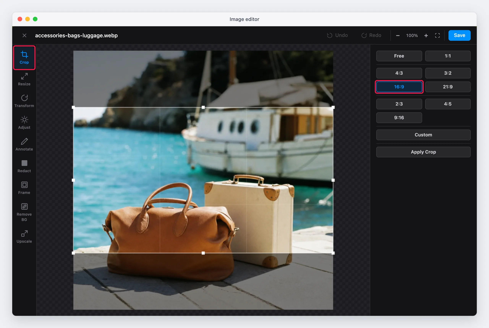

A ratio button sets the crop area once, in the center of the image. A handle does not keep the
ratio. To keep the ratio, move the area and do not drag the handles.

The grid in the crop area divides it into thirds. Put the product on a line or on a crossing of two
lines for a balanced photo.

## Resize

Resize changes the width and the height of the image in pixels.

1. Click **Resize** in the tool bar.
2. Type the **Width** or the **Height**. You can also drag the handles at the edges of the photo.
3. Click **Apply**, or press Enter.

If you click **Save** or open another tool before you apply, the editor applies the new size.

The lock button between the two fields keeps the aspect ratio. It is on when the tool opens. Click
it to set the width and the height freely.

The maximum size is 100 megapixels. To make a small photo larger, use [Upscale](#upscale) and not
Resize: a resize does not add detail, so a larger photo becomes blurred.

## Transform

Transform rotates and flips the image.

| Button | What it does |
|--------|--------------|
| **Rotate Left** | Rotates the image 90° counterclockwise |
| **Rotate Right** | Rotates the image 90° clockwise |
| **Flip Horizontal** | Mirrors the image from left to right |
| **Flip Vertical** | Mirrors the image from top to bottom |

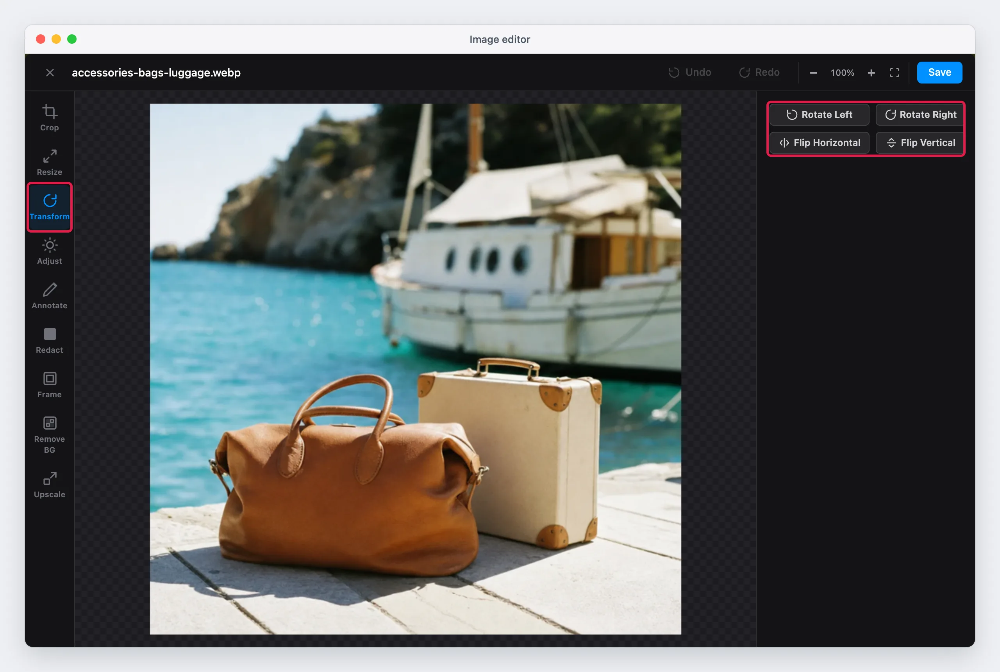

Each button applies at once.

## Annotate

Annotate adds shapes, text and other images on the photo. Use it for a "New" or "Sale" label, an
arrow that shows a detail, or a logo.

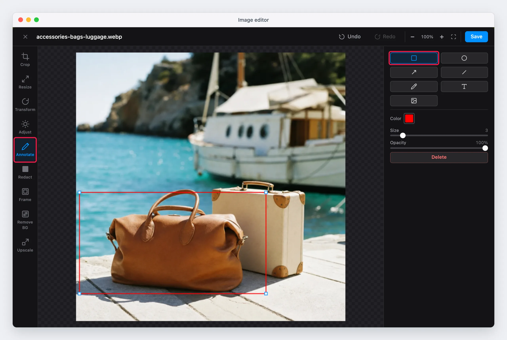

The buttons at the top of the options panel select the shape:

| Shape | How to draw it |
|-------|----------------|
| Rectangle | Drag. Hold Shift to draw a square. |
| Ellipse | Drag from the center. Hold Shift to draw a circle. |
| Arrow | Drag from the start to the point of the arrow. |
| Line | Drag from one end to the other. |
| Freehand | Drag to draw a free line. |
| Text | Click where the text starts, and type. Press Enter to finish. Press Shift+Enter for a new line. Press Escape to cancel. |
| Image | Click the photo, and select an image file on your computer. The image shows at one fifth of the width of the photo. |

The options under the shapes apply to the next annotation:

- **Color**: the color of the shape or of the text. The default color is red.
- **Size**: the thickness of the line, from 1 to 20. For text, the size of the letters, from 12 to
  120.
- **Font**: the font of the text. The list shows the fonts that are on your computer.
- **Opacity**: from 5% to 100%.

To change an annotation:

1. Click it to select it.
2. Drag it to move it. Drag a handle to change its size.
3. Change the options. They apply to the selected annotation.
4. To change a text, double-click it.

To delete the selected annotation, click **Delete** or press the Delete key.

## Redact

Redact hides a part of the photo, for example a name, an address, a phone number, a license plate or
a face.

1. Click **Redact** in the tool bar.
2. Select the style: **Solid Black** or **Pixelate**.
3. Drag over the area to hide. Repeat for each area.

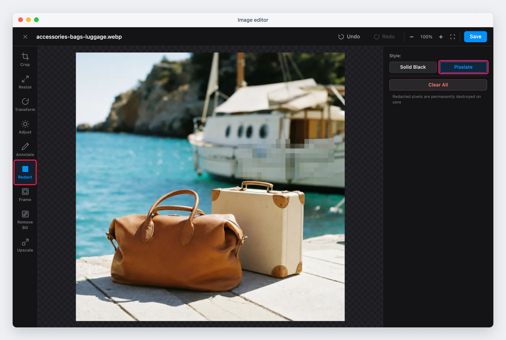

**Clear All** removes all the redacted areas. To remove only the last area, click **Undo**.

!!! warning "Delete the original file after you redact"
    The redacted pixels are gone from the file that you save. But if you save with a new name, the
    original file stays in the media library, with the private data. Delete the original file, or
    save with the same name.

Use **Solid Black** for text. A large pixelated area uses large blocks, but a person can sometimes
guess a short text under small blocks.

## Frame

Frame adds a border or a shadow around the image.

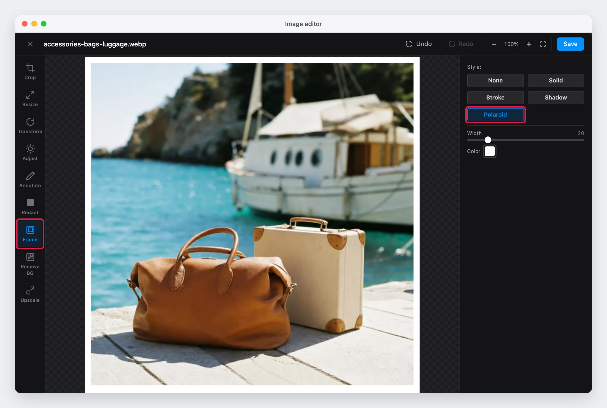

When you open Frame, the editor adds a white **Solid** frame at once. To remove the frame, click
**None**.

| Style | Options | Result |
|-------|---------|--------|
| **None** | | No frame |
| **Solid** | Width (5 to 100), Color | A border of the same width on all sides |
| **Stroke** | Position (Inside or Outside), Thickness (1 to 20), Padding (0 to 60), Color | A thin line around the image. **Inside** draws it on the image. **Outside** draws it around the image. **Padding** sets the gap between the line and the edge of the image. |
| **Shadow** | Width | A soft shadow around the image |
| **Polaroid** | Width, Color | A border that is three times wider at the bottom, as on an instant photo |

A frame outside the image makes the saved image larger. For example, a Solid frame of 20 px adds
40 px to the width and to the height. If all the product photos must have the same size, crop or
resize after you remove the frame, or use the same frame on all of them.

## Save the image

1. Click **Save**.
2. Type the file name, or keep the name of the original.
3. Click **OK**.

If you keep the name, the editor asks before it replaces the original file. If you type a new name,
the editor writes a new file in the same folder, and the original stays. If a file with the new name
already exists, the editor shows an error and saves nothing.

The editor saves the image in the file type and the quality of the store:

- **System > Configuration > Advanced > System > Storage Configuration for Media > File type for
  image conversions**. The default is WebP.
- **System > Configuration > Advanced > System > Storage Configuration for Media > Image quality**.
  The default is 85.

So the extension of the file can change. For example, with WebP, the editor saves `bag.jpg` as
`bag.webp`. In this case, the original `bag.jpg` stays in the folder, and the pages that use
`bag.jpg` still show the old image. Insert the new file in these pages.

When the editor replaces a file with the same name, the pages that use it show the new image. The
editor also makes the thumbnails of the media library again. A browser can show the old image from
its cache for a short time.

## The AI tools

Remove BG and Upscale use AI models that run in the browser of the admin user, on the processor or
the graphics card of the computer. Many image editors send the photo to an AI service in the cloud.
The Maho editor does not:

- The photo never leaves the computer while you edit it.
- No cloud service, AI provider or other third party receives the photo, a copy of it or data
  about it.
- There is no account, no API key, no subscription and no cost for each image.
- The tools work the same for a photo with private data, for example a photo before you redact it.

The first use of each tool downloads the model, and the status shows the progress of the download.
The download only receives the model. It sends no image and no data about the image. The browser
then keeps the model in its cache, so the next use starts fast.

| Tool | Model |
|------|-------|
| Upscale | [Real_HAT_GAN_sharper](https://github.com/XPixelGroup/HAT) (Apache-2.0), a download of 161 MB |
| Remove BG | [BEN2](https://huggingface.co/onnx-community/BEN2-ONNX) |

The browser downloads the models from `huggingface.co`, and the AI library from `cdn.jsdelivr.net`.
If a firewall or a proxy blocks these addresses, the AI tools show an error. The other tools work
without them.

A browser with WebGPU uses the graphics card, and the AI tools are much faster. Recent versions of
Chrome and Edge have WebGPU. Without WebGPU, the tools use the processor. They still work, but they
are slower.

## Example: make a product photo ready for the store

A supplier sends a photo of 400 × 300 px, with a gray background and a yellow cast. To make it
ready for the store:

1. **Crop** with the **1:1** ratio, to give the photo the shape of the other product photos.
2. **Upscale** with **4×**, to make the photo large enough for the zoom of the product page.
3. **Remove BG**, then apply a white **Solid** background.
4. **Adjust**: click **Auto**, then fine-tune **Temperature** and **Exposure**.
5. Drag across the photo to compare it with the original.
6. Click **Save**.

Crop first: a smaller image has fewer tiles, so the upscale is faster.
