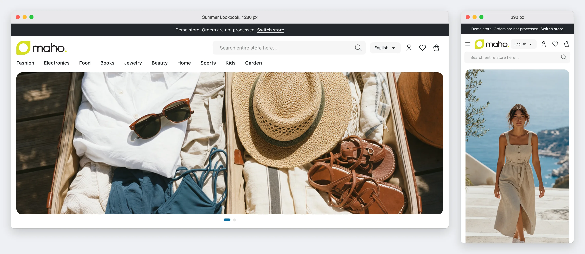
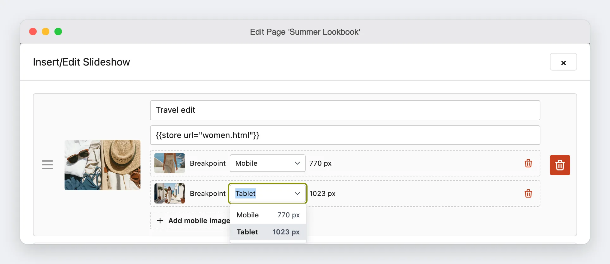

# Slideshow Images for Each Screen Size <span class="version-badge">v27.1+</span>

A slide of a slideshow can show a different image on a small screen. For example, a wide banner
shows on a computer, and a tall version of the same banner shows on a phone.



Each alternative image has a **breakpoint**. The breakpoint is the widest screen, in pixels, that
shows the alternative image. A screen that is wider than every breakpoint shows the default image of
the slide.

## Add an image for a small screen

1. Double-click the slideshow in the content editor.
2. Find the slide, then click **Add mobile image**.
3. Select the image in the media library.
4. In **Breakpoint**, select a preset from the list, or type a width in pixels, such as `900`.
5. Click **Insert Slideshow**, then save the page or the block.



A slide can have more than one alternative image, for example one for **Mobile** and one for
**Tablet**. Two images of the same slide cannot have the same width. The editor puts the narrowest
breakpoint first, because the browser uses the first image that matches the screen.

## Presets and custom widths

| Breakpoint | The content stores | After a change of the preset |
|------------|--------------------|------------------------------|
| A preset, such as **Mobile** | The name of the preset | The slide uses the new width |
| A width that you type, such as `900` | The width in pixels | The slide keeps its width |

After a preset, the field shows the width of the preset, such as **770 px**. Use a preset for most
slides. The presets come from the theme of the store, so the images change at the same widths as the
layout of the theme. Type a width for a slide that must change at a width of its own.

## The widths of the presets

The theme of the store view gives the width of each preset. You cannot change them in the admin.

| Theme | Mobile | Tablet |
|-------|--------|--------|
| Maho default and the industry themes | 770 | 1023 |
| Legacy | 770 | 979 |

A theme of your own takes the widths of its parent theme. A developer can change them in the
`theme.xml` of the theme (see [Breakpoints](../developer/theme-development.md#breakpoints)).

!!! warning "A slide with a preset and a custom width"
    The editor sorts the images of a slide when you save the slideshow. If the store later uses a
    theme with a preset on the other side of a custom width of the same slide, the order of the
    images is wrong. Open the slideshow and click **Insert Slideshow** again to sort the images.

    The editor sorts the images with the presets of one store view: the store view of the page or
    the block, or the default store view. If a page or a block shows in more than one store view,
    and the store views have themes with different presets, a custom width can be on a different
    side of a preset in each store view. Then no order is correct for all of them. In this case, use
    only presets or only custom widths in the slide, or make one page or block for each store view.

## Load speed of the images

The first image of a slideshow is often the largest image on the page. A slideshow tells the browser
to load that image first, and to load the other images only when they come near the screen.

In the dialog of the slideshow, the option **Load the first image with high priority on the page**
is on for a new slideshow. Clear it for a slideshow that is lower on the page, or for a second
slideshow, so that it does not compete with the main image of the page. The editor writes `fetchpriority="high"` on the
first image when the option is on, and `loading="lazy"` on each image after the first. A slide with
alternative images gets the attributes on the `` inside the `<picture>`.

A slideshow that you saved before has the option off. Open the slideshow, select the option, and
click **Insert Slideshow**.

## In the source view

The source view shows each alternative image as a `<source>` in a `<picture>`. A preset is a
`{{breakpoint}}` directive. The store replaces it with the width of the preset when it shows the
page.

```html
<picture>
    <source media="{{breakpoint code=mobile}}" srcset="{{media url="wysiwyg/banner-mobile.jpg"}}">
    <source media="(max-width: 1100px)" srcset="{{media url="wysiwyg/banner-tablet.jpg"}}">
    
</picture>
```

Write the code of the preset without quotes, as in the example. If the store does not know the
code, the browser never uses that image. It uses the next image that matches the screen, or the
default image.

The content editor removes a `<source>` whose `media` is not a preset or one `(max-width: ...px)`
value. When the editor opens the field, or when you leave the source view, it shows a message
before it removes the `<source>`. HTML that you paste into the editor gets no message, so write a
slideshow with alternative images in the source view.
