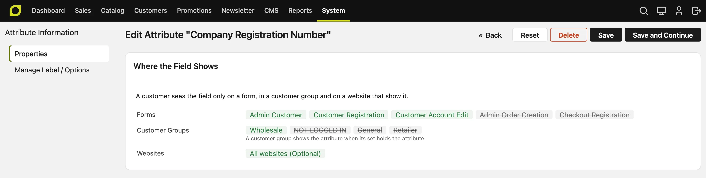
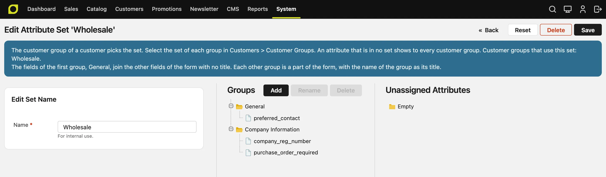
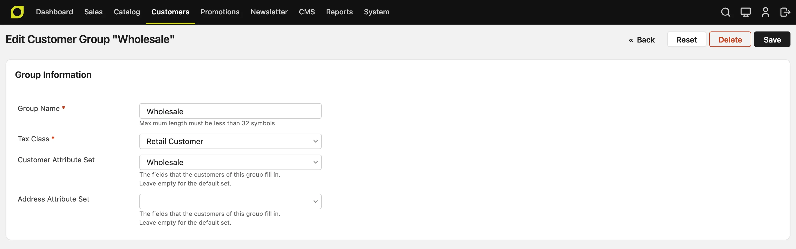
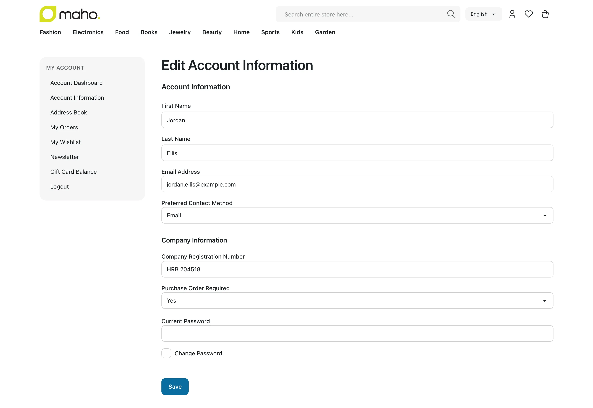
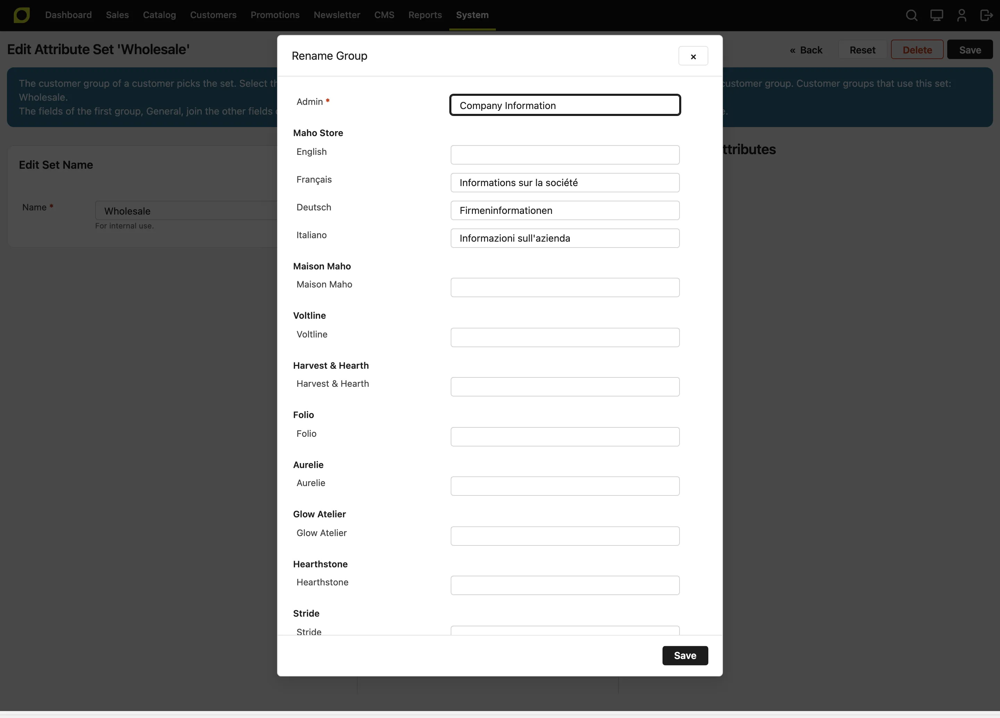

# Customer and Address Attributes v27.1+

A customer attribute is a field of a customer, such as **Date of Birth**. An address attribute is a
field of an address, such as **Company**. You can add your own attributes, for example a company
registration number for business customers, or delivery hours for an address.

## Add an attribute

1. Go to **System > Attributes > Customers**, or to **Customer Addresses** for an address
   field.
2. Click **Add**.
3. Enter the **Attribute Code** and select the **Input Type**. You cannot change them later. An
   address attribute can also use **Multiple Lines**, with the number of lines in **Lines Count**.
4. In **Used in Forms**, select the forms that show the field. Hold the Ctrl or Cmd key to select
   more than one form.
5. In **Default**, select **Hidden**, **Optional** or **Required**.
6. On the **Manage Label / Options** tab, enter the label, and the options of a Dropdown or a
   Multiple Select.
7. Click **Save**.

A new attribute goes into the first group of the **Default** set. So it shows at once to every
customer group that uses the default set.

The forms of a customer attribute:

| Form | Where it shows |
|---|---|
| Admin Customer | The **Account Information** tab of a customer in the admin |
| Admin Order Creation | The account section of a new order in the admin |
| Customer Registration | The registration page of the storefront |
| Customer Account Edit | **Account Information** in the customer account |
| Checkout Registration | The account section of the checkout, when the customer registers there |

The forms of an address attribute:

| Form | Where it shows |
|---|---|
| Admin Customer Address | The addresses of a customer, and the addresses of a new order, in the admin |
| Address Book and Checkout | The address book of the customer account, and the billing and shipping steps of the checkout |
| Customer Registration | The address section of the registration page, when the store asks for an address there |

The **Default** field applies to all the forms:

- **Hidden**: no form shows the field.
- **Optional**: the forms show the field, and the customer can leave it empty.
- **Required**: the forms show the field, and the customer must fill it in.

A standard field, such as **Date of Birth**, gets its **Hidden** setting from **System >
Configuration > Customers > Customer Configuration**. So its **Default** field offers only
**Optional** and **Required**.

**Sort Order** sets the place of the field in a form.

## Show a field only when another field has a value

A condition shows a field only when other fields of the same form have some values. For example,
an address field **SdI Code** can show only when the **Country** is Italy.

1. Open the attribute in **System > Attributes > Customers** or **Customer Addresses**.
2. Go to the **When the Field Shows** section.
3. Click **Add**.
4. In the first list, select the field that decides, for example **Country**.
5. In the second list, select the values that show the field, for example **Italy**. Hold the Ctrl
   or Cmd key to select more than one value. Select **Any Value** to show the field when the other
   field has a value, whatever it is.
6. To add more fields, click **Add** again. Then, in **Show the field when**, select how the rows
   join:
    - **Each row matches**: every row must match.
    - **At least one row matches**: one row is enough.
    - **No row matches**: the field shows only when no row matches.
    - **Exactly one row matches**: one row must match, and the other rows must not.
7. Click **Save**.

The rules of a condition:

- A condition can read only the fields of the same record. An address field can read the
  **Country** or another address field, and never a field of the customer.
- A condition can read a field with a list of values: a **Dropdown**, a **Multiple Select**, a
  **Yes/No** field, or a standard field such as **Country** or **Gender**.
- A condition can also read a **Text Field**, a **Text Area** or a **Date**, such as **Company**.
  These fields have no list, so the only value is **Any Value**. For example, **VAT Number** can
  show only when **Company** has a value. To show a field when another field is empty, select
  **Any Value** and **No row matches**.
- A field that a condition reads cannot have a condition of its own.
- You cannot delete a field while a condition reads it. Remove the condition first.
- A standard field, such as **Company**, **VAT Number**, **Tax/VAT Number**, **Date of Birth** or
  **Gender**, can have a condition too. The store always requires some standard fields, so they
  have no **When the Field Shows** section: the name, the email, the website and the group of a
  customer, and the name, the street, the city, the country, the state, the zip code and the
  telephone of an address.

When the condition hides a field:

- The forms of the storefront and the admin do not show the field. They show it again as soon as
  the customer selects a value that matches.
- The field is not required, also when **Default** is **Required**. So **Required** with a condition
  means "required only when the field shows".
- The field keeps its value. If the customer selects a value that matches again, the field shows
  with its old value. The API and the imports apply the same rule.
- The address does not print the field: in the address book, at checkout, on the order pages, in
  the emails and on the PDFs.

### Example: the Italian invoice fields

An Italian company needs its VAT number and an SdI code or a PEC address on its invoices. A private
customer does not. A condition cannot read a field of the customer from an address, so the customer
type must be an address field:

1. In **System > Attributes > Customer Addresses**, add a **Dropdown** with the label
   **Customer Type** and the options **Private** and **Company**. In **Used in Forms**, select
   the address forms.
2. Add the text fields **SdI Code** and **PEC**, with the same forms.
3. Open **SdI Code**. In **When the Field Shows**, add the row **Customer Type** is **Company**,
   then the row **Country** is **Italy**. In **Show the field when**, select **Each row matches**.
4. Do the same for **PEC** and for the standard fields **Company** and **VAT Number**.
5. To require a field only for Italian companies, set its **Default** to **Required**.

A customer in the United States, or a private customer in Italy, then sees none of these fields.

The address forms of an order in the admin always show the field, and they do not mark it as
required: the forms of a new order, and the form that changes an address of an order. A new order
still requires the field when the condition shows it.

## Check where a field shows

Three settings decide if a customer sees a field: the forms of the attribute, the attribute set of
the customer group, and the setting of the website. The edit page of a saved attribute starts with
the section **Where the Field Shows**, which lists the three:

- **Forms**: every form. A form that does not show the attribute has a line through it.
- **Customer Groups**: every customer group. A group whose set does not hold the attribute has a
  line through it. An attribute in no set shows to no group.
- **Websites**: the setting of each website: **Hidden**, **Optional** or **Required**. When all the
  websites use one setting, the row shows **All websites** and the setting.

When a customer does not see a field, read this summary first.

## Input rules

The values that a customer enters must follow the **Input Rules** of the attribute:

- **Input Filter**: **Strip HTML Tags** removes HTML from the value. **Escape HTML Entities** keeps
  the tags as text.
- **Minimum Text Length** and **Maximum Text Length**: the number of characters of a text.
- **Value Format**: letters, numbers, letters and numbers, an email address, or a URL.

## Fields for each customer group

An attribute set is a list of attributes. Each customer group uses one customer set and one address
set. A group with no set uses the default set.

For example, wholesale customers give a company registration number, and retail customers do not:

1. Add the attribute, as in [Add an attribute](#add-an-attribute). It goes into the **Default** set.
2. Go to **System > Attributes > Customers**, click **Attribute Sets**, and click **Add**.
3. Enter **Wholesale**, select **Default** in **Based On**, and click **Save**. The new set holds the
   attribute too.
4. Open the **Default** set. Drag the attribute to **Unassigned Attributes**, and click **Save**.
   The page asks first, because the retail groups stop seeing the field.
5. Go to **Customers > Customer Groups** and open the **Wholesale** group.
6. Select **Wholesale** in **Customer Attribute Set**, and click **Save**.

A form shows an attribute only when the set of the group holds it. An attribute in no set shows
to no group. When you take an attribute out of a set, the values of the customers stay in the
database, and the field shows again when you put it back.

The set page lists only the attributes that you added. The standard fields, such as
**First Name** and **Email**, are in every set, and you cannot remove them.

The groups of the set split a form into sections:

- The attributes of the first group of the set show with the standard fields.
- Each other group that has a field of the form is a section with its own title, for example
  **Company Information**. The title is the name of the group, in the language of the store view.
  The customer page in the admin also shows each group as a section, with the **Admin** name.

The set page shows the same note, with the name of the first group.

To pick the set of a form, the store uses the customer group in this order:

1. The group of the customer.
2. For an address in the checkout, the group of the cart. A guest has the **NOT LOGGED IN** group.
3. For a customer who registers, the **Default Group** in **System > Configuration > Customers >
   Customer Configuration > Create New Account Options**. This setting can be different for each
   store view, so a business website can give its new customers a business group and its fields.

When a customer moves to another group, the values of the fields of the old set stay in the
database. The customer account edit page shows the fields of the new set.

## Translate the name of a group

The name of a group is the title of its section in the forms. You can give the section a different
title in each language.

1. On the set page, click the group, then click **Rename**. To make a new group, click **Add**.
2. In **Admin**, enter the name that the admin shows. Two groups of one set cannot have the same
   name.
3. In the row of each store view, enter the name in the language of that store view. If you leave a
   row empty, the store view shows the **Admin** name.
4. Click **Save** in the window, then click **Save** on the set page.

## Fields for each website

The **Websites** section of an attribute can change the default for one website:

- **Hidden**: the forms of the website do not show the field.
- **Optional**: the forms show the field, and the customer can leave it empty.
- **Required**: the forms show the field, and the customer must fill it in.
- **Use Default**: the website uses the **Default** field of the attribute. The option shows the
  result, for example **Use Default (Optional)**.

A store with one website does not show the **Websites** section, because the default already decides.

Use a website setting when the field depends on the website, and an attribute set when it depends
on the customer group.

## Customer attributes on orders

The checkout copies the values of the customer attributes to the order, so the order keeps what was
true when the customer bought, also after the customer changes the value:

- The order keeps the value, and the label of a **Dropdown**, a **Multiple Select** or a **Yes/No**
  option in the language of the store view of the order.
- A customer who registers at checkout gets the values of the **Checkout Registration** form.
- A reorder from the admin copies the values to the new cart.

The **Account Information** part of the order page in the admin shows each customer attribute that
has a value. The invoice, shipment and credit memo PDFs show only the attributes that a form of the
storefront shows, because the documents go to the customer.

Each customer attribute adds a column `customer_` + its **Attribute Code** to the carts and the orders.
So the code of a customer attribute cannot make the name of a field that orders already have, such
as `note` for `customer_note`. When you delete a customer attribute, the orders keep its values, so a
new customer attribute cannot use the code of a deleted one.

## Address attributes on orders

The checkout copies the values of the address attributes to the order:

- The cart and the order keep the value that the customer selected.
- The order also keeps the label of a **Dropdown**, a **Multiple Select** or a **Yes/No** option, in the
  language of the store view of the order. So the order shows what the customer saw, also after you
  change or delete the option.
- A reorder from the admin copies the values back to the new cart.

Each address attribute adds a column with its **Attribute Code** to the order addresses. So the code of
an address attribute cannot be the name of a field that orders already have, such as `subtotal`. When you
delete an address attribute, the carts and the orders keep its values. So a new address attribute cannot
use the code of a deleted one.

The order page in the admin, the order emails, the invoices and the other PDFs show each address
attribute that has a value, as a line with its label, for example **Delivery Hours: 9-17**. An
attribute that only the **Admin Customer Address** form shows stays out, because the emails go to the
customer. To put a value in another place, add `{{var attribute_code}}` to the address template in
**System > Configuration > Customers > Customer Configuration > Address Templates**. The store then
does not add the line.

## Customer segments

The conditions **Customer Personal Information** and **Customer Address** of a customer segment
list your customer and address attributes too. For example, a segment can hold the customers whose
**Business Type** is **Wholesaler**.

## The API

The REST, GraphQL and MCP APIs read and write the values in `customAttributes`, by attribute code.
An order returns the customer values in `customerCustomAttributes`, and their labels in
`customerCustomAttributeLabels`.
A **Dropdown** is an option ID, a **Multiple Select** a list of option IDs, and a **Yes/No** `true` or
`false`. A write follows the **Input Rules** of the attribute. The order addresses return the option IDs
too, and `customAttributeLabels` returns the labels that the customer saw.

An admin token or an API token reads and writes the attributes of the **Admin Customer** and the
**Admin Customer Address** forms. `GET /api/rest/v2/custom-attributes?entityType=customer` and
`?entityType=customer_address` list the attributes, their options and their attribute sets.

A customer token, and a guest who registers or checks out, reads and writes only the attributes that
the storefront forms show to the customer group on the website, as on the storefront:

- A registration takes the attributes of **Customer Registration**, and must send each required one.
- An update of the customer takes the attributes of **Customer Account Edit**.
- An address of the address book and an address of the cart take the attributes of **Address Book and
  Checkout**. A new address of the address book must send each required one.
- A cart address, set with the address endpoints of the cart or in the body of the place-order
  request, must send each required one, because the checkout sets the whole address at once. On the
  cart, `sameAsShipping` copies the values of the shipping address to the billing address. The order
  copies the values from the cart.
- A guest order takes the attributes of **Checkout Registration** in `customerCustomAttributes` of the
  place-order body, and must send each required one, as the storefront checkout does. A customer
  order takes the values of the customer account, so its body must not send `customerCustomAttributes`.

`GET /api/rest/v2/customer-forms/{form}` and the GraphQL `customerForm` query list the fields of a
storefront form for the customer group of the caller: the label in the store view, the input type, the
options, the required flag and the group title. The form is `customer_account_create`,
`customer_account_edit`, `checkout_register`, `customer_address_edit` or `customer_register_address`.
Each field also has `dependsOn`: `null`, or the condition of the field, as
`[{"operator": "AND", "condition": {"country_id": ["IT"]}}]`. A headless storefront shows the field
only when the condition is true. When the condition is false, the API does not require the field. It
still checks and saves a value that the request sends, and it returns the saved value.
