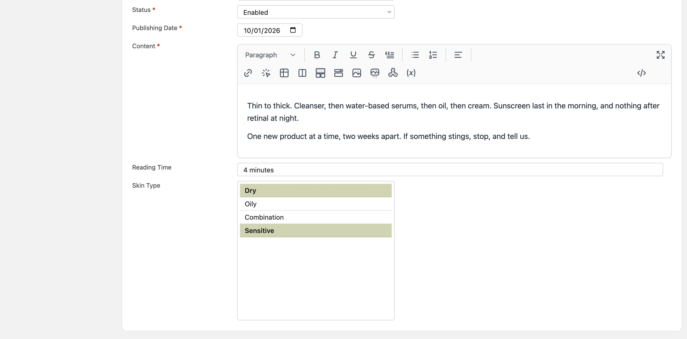
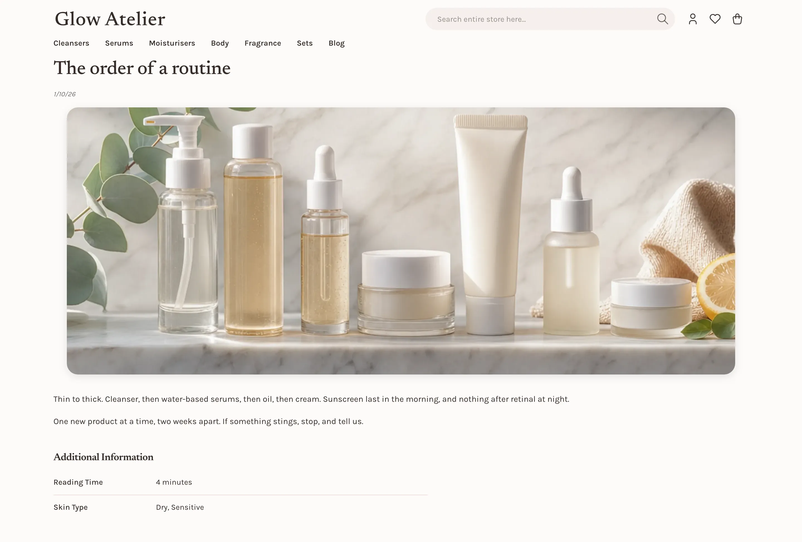

# Blog Attributes and Attribute Sets v27.1+

A blog attribute is a field of a blog post or a blog category, for example a reading time or an
author. An attribute set is a list of attributes in groups. Each post and each category uses one
set. The fields of the blog itself, such as **Title**, **Image** and **Content**, are not
attributes, so the attribute grid and the sets show only the attributes that you add.

## Add an attribute

1. Go to **System > Attributes > Blog Posts**, or to **Blog Categories** for a category field.
2. Click **Add**.
3. Enter the **Attribute Code** and select the **Input Type**. You cannot change them later.
4. On the **Manage Label / Options** tab, enter the label, and the options of a Dropdown or a
   Multiple Select.
5. Click **Save**.

A blog attribute has one value for all store views.

A new attribute goes into the first group of the **Default** set. The edit page of a post shows
it at once, on the **Content** tab, below the fields of the blog. On a category, it shows on the
**General** tab.

## Put the attribute on a tab

1. Go to **System > Attributes > Blog Posts**, or to **Blog Categories**, and click
   **Attribute Sets**.
2. Click the set, for example **Default**.
3. Drag the attribute to another group, or from **Unassigned Attributes** to a group. To add a
   group, click **Add** above the groups.
4. Click **Save**.

The attributes of the first group of the set show on the **Content** tab of a post and on the
**General** tab of a category. Each other group that holds an attribute is a tab of its own, with
the name of the group.

When there is more than one set, a post or a category shows the **Attribute Set** field. When you
select another set, the page shows the fields of that set at once, and keeps the values that you
entered. When the new set of a saved post or category does not have some attributes of the old set,
the page asks first and names them. When you save, the post or the category loses its values of
these attributes.

Do not take an attribute out of a set by mistake. Every night, the store deletes the value of an
attribute that is not in the set of its post or category. When a save of the set page takes an
attribute out, the page asks first, and names the number of posts or categories that have a value.

## Show a field only when another field has a value

A condition shows a field only when other fields of the same form have some values. For example, a
field **Event Date** can show only when the field **Post Type** is **Event**.

1. Open the attribute in **System > Attributes > Blog Posts** or **Blog Categories**.
2. Go to the **When the Field Shows** section.
3. Click **Add**, then select the field that decides and the values that show the field. Hold the
   Ctrl or Cmd key to select more than one value.
4. For more than one row, select in **Show the field when** if each row, at least one row, no row
   or exactly one row must match.
5. Click **Save**.

A condition can read a field with a list of values, such as a **Dropdown**, a **Yes/No** field, or
the **Status**. It can also read a **Text Field**, a **Text Area** or a **Date**, with the value
**Any Value**: the condition then asks only whether the field has a value. A field that a condition
reads cannot have a condition of its own, and you cannot delete it while a condition reads it.

When the condition hides a field, the edit page does not show it, and the field is not required. The
field keeps its value, so the value comes back when the condition shows the field again. The table
of values on the storefront does not show a hidden field. The API applies the same rule. A field on
another tab reads the saved value of the field that decides, not the value that you just changed.
Save the post to update it.

The section **When the Field Is Required** works in the same way, and makes an optional field
required only when the other fields have some values. It can read a field that has a condition of
its own.

## Show the attribute on the storefront

Set **Visible on Frontend** to **Yes** in the **Frontend Properties** of the attribute. The post
page or the category page then shows the attribute and its value in a table. A post with no value
for the attribute does not show it.

A **Text Area** value shows under the table, with the label of the attribute as its title, because a
long text does not fit in a table.

Each group of the set is a table of its own, in the order of the groups. The table of the first
group has the title **Additional Information**. Each other table has the name of its group, in the
language of the store view. In each table, the attributes follow the order of the group. To change
the order, drag the attribute in the set.

The table shows HTML when **Allow HTML Tags on Frontend** or **Enable WYSIWYG** is **Yes**. It
removes unsafe HTML, such as a script. A code in braces, such as `{{store url=""}}`, works only when
both settings are **Yes**. In other cases, the table removes the code.

## Translate the name of a group

The name of a group is the title of its tab in the admin, and the title of its table on the
storefront. You can give the table a different title in each language.

1. On the set page, click the group, then click **Rename**. To make a new group, click **Add**.
2. In **Admin**, enter the name that the admin shows. Two groups of one set cannot have the same
   name.
3. In the row of each store view, enter the name in the language of that store view. If you leave a
   row empty, the store view shows the **Admin** name.
4. Click **Save** in the window, then click **Save** on the set page.

## The URL key of a post

The **URL Key** of a post is the last part of its address. The admin form, the import and the API
use the same rules:

- The URL key has only lowercase letters, digits and dashes, for example `summer-sale-2026`. It
  does not start or end with a dash, and it has no two dashes in sequence. A save with another
  URL key shows "The URL key ... must have only lowercase letters, digits and dashes." The API
  answers 422.
- Two posts that share a store view cannot have the same URL key. A post in **All Store Views**
  shares each store view. A save shows "Another post of the same store view has the URL key ...".
  The API answers 409.
- When you leave the URL key empty, the store makes it from the title.
- A post that was saved before these rules keeps its URL key. The store checks the URL key again
  only when you change it.

## Import

The blog post import reads two more kinds of columns:

- `_attribute_set`: the name of the set of the post, as in the product import.
- A column with the code of an attribute that you added. A Dropdown or a Yes/No takes the label of
  the option. A Multiple Select takes labels with commas between them.

An import refuses a value for an attribute that is not in the set of the post.

## The API

The blog posts and blog categories of the REST and GraphQL API have two more fields. Only an admin
and an API token can read and write them:

- `attributeSetId`: the set of the post or the category. A new one without a set takes the default
  set. An update can change the set. The next night, the store deletes the values of the
  attributes that are not in the new set.
- `customAttributes`: the values of the attributes that you added, by attribute code. A write
  refuses a code that is not in the set of the post or the category, and a value that is not an
  option of a Dropdown. A new post or category must get each required attribute. A Dropdown is an option ID, a Multiple
  Select a list of option IDs, and a Yes/No `true` or `false`.

`GET /api/rest/v2/custom-attributes?entityType=blog_post` (or `blog_category`) lists the attributes, their options and their sets.
