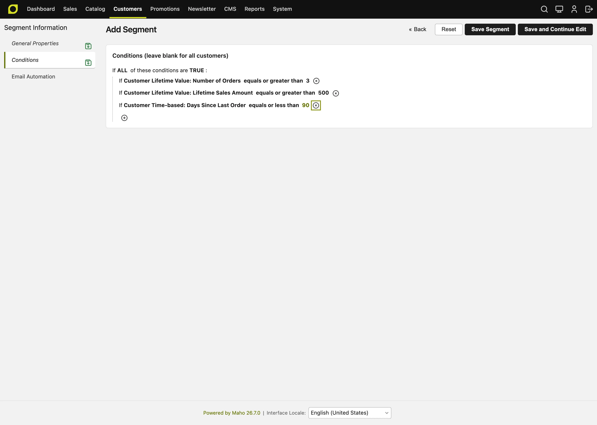

# Customer Segments <span class="version-badge">v25.9+</span>

Customer Segments in Maho enable you to create dynamic groups of customers based on powerful, real-time conditions. Target specific customer behaviors, demographics, purchase patterns, and engagement metrics to deliver personalized experiences, targeted promotions, and automated marketing campaigns.

## Overview

Customer segmentation is a fundamental feature for data-driven marketing and personalization:

- **Dynamic targeting**: Automatically match customers based on real-time conditions
- **Rich condition types**: 13+ condition categories covering customer data, orders, cart, and behavior
- **Sales rule integration**: Use segments for targeted pricing and promotions
- **Email automation**: Trigger automated email sequences (see [Email Automation](email-automation.md))
- **Website-aware**: Scope segments to specific websites
- **Performance optimized**: Efficient SQL queries with smart caching

## Key Benefits

### For Marketing Teams
- **Precision targeting**: Reach the right customers with the right message
- **Behavioral triggers**: React to customer actions in real-time
- **Campaign performance**: Measure segment-specific conversion rates
- **Reduced waste**: Stop broadcasting, start targeting

### For E-commerce Managers
- **Personalized pricing**: Offer segment-specific discounts and promotions
- **Inventory management**: Target promotions to move slow-moving stock
- **Customer retention**: Identify at-risk customers before they churn
- **Lifetime value optimization**: Focus on high-value customer segments

### For Business Owners
- **Revenue growth**: Increase conversion through personalization
- **Customer insights**: Understand your customer base through segmentation
- **Operational efficiency**: Automate targeting and promotions
- **Competitive advantage**: Deliver enterprise-level personalization

## Segment Conditions

Maho provides 13 powerful condition types to create sophisticated customer segments:

<figure markdown="span">

<figcaption>Building segment conditions with the visual rule editor</figcaption>
</figure>

### 1. Customer Personal Information

Target customers by their profile data:

| Attribute | Type | Example Use Case |
|-----------|------|------------------|
| **Email** | Text | VIP customer list by domain (@company.com) |
| **First Name** | Text | Personalization testing |
| **Last Name** | Text | Family account grouping |
| **Gender** | Select | Gender-specific product promotions |
| **Date of Birth** | Date | Age-based targeting |
| **Customer Since** | Date | Loyalty program tiers by tenure |
| **Customer Group** | Multi-select | Wholesale vs. Retail pricing |
| **Account Created In Store** | Multi-select | Store-specific campaigns |
| **Days Since Registration** | Numeric | New customer onboarding (< 30 days) |
| **Days Until Birthday** | Numeric | Birthday promotions (0-7 days) |

**Example**: Birthday Campaign
```
Conditions:
- Days Until Birthday: equals 0
- Newsletter: Subscribed
```

---

### 2. Customer Address

Segment by billing or shipping address:

| Attribute | Example |
|-----------|---------|
| **Country** | International shipping promotion |
| **State/Province** | Region-specific offers |
| **City** | Local store pickup campaigns |
| **Postal Code** | ZIP code targeting |
| **Street Address** | (Rarely used) |

**Example**: Free Shipping to California
```
Conditions:
- Shipping Address: State equals CA
- Order: Total Ordered Amount > $50
```

---

### 3. Customer Lifetime Value (CLV)

Identify high-value and VIP customers:

| Metric | Use Case |
|--------|----------|
| **Lifetime Sales Amount** | VIP program qualification ($1000+) |
| **Number of Orders** | Repeat customer identification (>3) |
| **Average Order Value** | Premium customer targeting ($200+ AOV) |
| **Lifetime Profit** | True profitability segmentation |
| **Lifetime Refunds** | Problem customer identification |

**Example**: VIP Customer Segment
```
Conditions:
- Lifetime Sales Amount: greater than $1000
- Number of Orders: greater than 5
- Lifetime Refunds: less than $100
```

---

### 4. Newsletter Subscription

Target by subscription status:

| Status | Use Case |
|--------|----------|
| **Subscribed** | Email marketing campaigns |
| **Unsubscribed** | Re-engagement offers (non-email) |
| **Not Subscribed** | Subscription drive promotions |

**Example**: Subscription Drive
```
Conditions:
- Newsletter: Not Subscribed
- Number of Orders: greater than 0
```

---

### 5. Shopping Cart Attributes

Target customers based on their active cart:

| Attribute | Type | Example |
|-----------|------|---------|
| **Cart Status** | Select | Active vs. Inactive |
| **Cart Items Count** | Numeric | Multi-item discount |
| **Cart Subtotal** | Numeric | High-value cart incentive |
| **Cart Grand Total** | Numeric | Threshold-based shipping |
| **Cart Tax Amount** | Numeric | Tax analysis |
| **Cart Discount Amount** | Numeric | Discount usage tracking |
| **Cart Updated Date** | Date | Abandonment timeframe |
| **Days Since Cart Update** | Numeric | Cart abandonment (>1 hour) |

**Example**: High-Value Cart Abandonment
```
Conditions:
- Cart Status: equals Active
- Cart Grand Total: greater than $200
- Days Since Cart Update: greater than 0.04 (1 hour)
```

---

### 6. Shopping Cart Items

Target based on specific products in cart:

| Condition | Use Case |
|-----------|----------|
| **Product SKU** | Specific product targeting |
| **Product Name** | Product line promotions |
| **Category** | Category-level incentives |
| **Price** | Price range filtering |
| **Quantity** | Bulk purchase detection |

**Example**: Complete the Set
```
Conditions:
- Cart Items: Category equals "Cameras"
- Cart Items: SKU does not contain "memory-card"
```
*Prompt: Add memory card to complete your camera kit!*

---

### 7. Order Information

Segment by historical order data:

| Attribute | Type | Example |
|-----------|------|---------|
| **Total Items Quantity** | Numeric | Bulk buyers |
| **Total Amount** | Numeric | High-value order threshold |
| **Subtotal** | Numeric | Pre-tax/shipping amount |
| **Tax Amount** | Numeric | Geographic tax analysis |
| **Shipping Amount** | Numeric | Shipping cost sensitivity |
| **Discount Amount** | Numeric | Coupon usage patterns |
| **Grand Total** | Numeric | Complete order value |
| **Order Status** | Select | Completed, Pending, Canceled |
| **Purchase Date** | Date | Seasonal purchase patterns |
| **Last Modified** | Date | Recently updated orders |
| **Store** | Select | Multi-store targeting |
| **Currency** | Select | International customers |
| **Payment Method** | Select | Payment preference targeting |
| **Shipping Method** | Select | Delivery preference analysis |
| **Coupon Code** | Text | Specific promotion tracking |
| **Days Since Last Order** | Numeric | Win-back campaigns (>90 days) |
| **Average Order Amount** | Numeric | Average spend analysis |
| **Total Ordered Amount** | Numeric | Cumulative order value |

**Example**: Inactive Customer Win-back
```
Conditions:
- Days Since Last Order: greater than 90
- Number of Orders: greater than 1
- Newsletter: Subscribed
```

---

### 8. Order Items

Target based on previously purchased products:

| Condition | Use Case |
|-----------|----------|
| **Product SKU** | Replenishment campaigns |
| **Product Name** | Product line cross-sell |
| **Category** | Category affinity targeting |
| **Price** | Price sensitivity analysis |
| **Quantity** | Bulk buyer identification |

**Example**: Replenishment Campaign
```
Conditions:
- Order Items: SKU equals "COFFEE-BEANS-500G"
- Order: Purchase Date was 30 days ago
```
*Prompt: Time to reorder your favorite coffee!*

---

### 9. Product Viewed

Target customers who viewed specific products:

| Condition | Use Case |
|-----------|----------|
| **Product** | Browse abandonment recovery |
| **Viewed Date** | Recent interest targeting |
| **View Count** | High-intent browsers |

**Example**: Browse Abandonment
```
Conditions:
- Product Viewed: Category equals "Laptops"
- Product Viewed: Viewed Date was in last 7 days
- Number of Orders: equals 0 (no purchase yet)
```

---

### 10. Product in Wishlist

Target based on wishlist activity:

| Condition | Use Case |
|-----------|----------|
| **Product** | Wishlist reminder campaigns |
| **Added Date** | Aged wishlist items |
| **Wishlist Name** | (If using named wishlists) |

**Example**: Wishlist Reminder
```
Conditions:
- Product in Wishlist: Added Date was 14+ days ago
- Newsletter: Subscribed
```
*Prompt: Still dreaming about these items? Here's 10% off!*

---

### 11. Combine Conditions

Use logical operators to create complex segments:

- **ALL** (AND): All conditions must be true
- **ANY** (OR): At least one condition must be true
- **NOT ALL**: At least one condition must be false

**Example**: High-Value Abandoned Cart OR Long-Time Inactive
```
Combine: ANY of the following
  Sub-group 1 (ALL):
    - Cart Status: Active
    - Cart Grand Total: > $200
    - Days Since Cart Update: > 1 day

  Sub-group 2 (ALL):
    - Days Since Last Order: > 180
    - Lifetime Sales: > $500
```

## Practical Examples

### Example 1: VIP Customer Tier

**Goal**: Identify top-spending customers for exclusive benefits

**Segment Configuration**:
```
Name: VIP Platinum Tier
Conditions (ALL):
- Lifetime Sales Amount: greater than $5000
- Number of Orders: greater than 10
- Average Order Value: greater than $200
- Lifetime Refunds: less than 5% of Lifetime Sales
Website: All Websites
Active: Yes
```

**Use Cases**:
- Exclusive product access
- VIP pricing tiers (via sales rules)
- Dedicated customer service
- Invitation-only events

---

### Example 2: Cart Abandonment - High Value

**Goal**: Recover high-value abandoned carts

**Segment Configuration**:
```
Name: Cart Abandoned $200+
Conditions (ALL):
- Shopping Cart: Status equals "Active"
- Shopping Cart: Grand Total greater than $200
- Shopping Cart: Days Since Update greater than 0.04 (1 hour)
- Newsletter: Subscription Status equals "Subscribed"
Website: All Websites
Auto Email: Enabled (Enter Segment)
Active: Yes
```

**Email Sequence**:
1. 1 hour: Gentle reminder
2. 24 hours: 10% discount coupon
3. 7 days: 15% + free shipping

**Expected ROI**: 20-25% recovery rate

---

### Example 3: New Customer Welcome

**Goal**: Nurture first-time customers

**Segment Configuration**:
```
Name: New Customers - No Orders
Conditions (ALL):
- Customer: Days Since Registration less than 30
- Customer: Number of Orders equals 0
- Newsletter: Subscribed
Website: All Websites
Auto Email: Enabled (Enter Segment)
Active: Yes
```

**Email Sequence**:
1. Immediate: Welcome + 15% off first order
2. 3 days: Product guide & bestsellers
3. 7 days: Customer testimonials
4. 14 days: Last chance offer

---

### Example 4: Win-back Inactive Customers

**Goal**: Re-engage customers who haven't ordered in 6 months

**Segment Configuration**:
```
Name: Inactive 180+ Days
Conditions (ALL):
- Order: Days Since Last Order greater than 180
- Order: Total Orders greater than 1
- Newsletter: Subscribed
- Lifetime Sales: greater than $100
Website: All Websites
Auto Email: Enabled (Enter Segment)
Active: Yes
```

**Strategy**:
- Email sequence with progressive discounts
- Showcase new products since last visit
- "We miss you" personalization

---

### Example 5: Birthday Campaign

**Goal**: Send birthday offers to customers

**Segment Configuration**:
```
Name: Today's Birthdays
Conditions (ALL):
- Customer: Days Until Birthday equals 0
- Newsletter: Subscribed
Website: All Websites
Auto Email: Enabled (Enter Segment)
Refresh Mode: Auto (Daily refresh)
Active: Yes
```

**Email**:
- Birthday greeting
- 20% birthday discount coupon (30-day expiration)
- Free shipping

---

### Example 6: Category Affinity - Cross-sell

**Goal**: Target customers who bought from one category with related products

**Segment Configuration**:
```
Name: Camera Buyers - No Accessories
Conditions (ALL):
- Order Items: Category equals "Cameras"
- Order: Purchase Date was in last 90 days
- Order Items: Category does not equal "Camera Accessories"
Website: All Websites
Active: Yes
```

**Sales Rule**: 15% off camera accessories

---

### Example 7: Geographic Expansion

**Goal**: Target new shipping regions

**Segment Configuration**:
```
Name: UK Customers - New Region
Conditions (ALL):
- Shipping Address: Country equals "United Kingdom"
- Customer: Created At after 2026-01-01
Website: UK Website
Auto Email: Enabled (Enter Segment)
Active: Yes
```

**Welcome Sequence**:
1. Welcome to UK store
2. Free shipping on first order
3. Local customer success stories

---

### Example 8: Repeat Purchase Cycle

**Goal**: Trigger replenishment for consumable products

**Segment Configuration**:
```
Name: Coffee Replenishment Due
Conditions (ALL):
- Order Items: Category equals "Coffee"
- Order: Purchase Date was 28-35 days ago
- Newsletter: Subscribed
Website: All Websites
Auto Email: Enabled (Enter Segment)
Active: Yes
```

**Email**: "Time to restock your coffee!"

---

### Example 9: High-Intent Browsers

**Goal**: Convert browsers who viewed expensive items

**Segment Configuration**:
```
Name: High-Value Browsers - No Purchase
Conditions (ALL):
- Product Viewed: Price greater than $500
- Product Viewed: Viewed in last 7 days
- Number of Orders: equals 0
- Newsletter: Subscribed
Website: All Websites
Active: Yes
```

**Strategy**: Personal consultation offer, financing options

---

### Example 10: Loyalty Tier Advancement

**Goal**: Motivate customers close to next loyalty tier

**Segment Configuration**:
```
Name: $50 Away from Gold Tier
Conditions (ALL):
- Lifetime Sales: greater than $950
- Lifetime Sales: less than $1000
- Days Since Last Order: less than 60
Website: All Websites
Auto Email: Enabled (Enter Segment)
Active: Yes
```

**Email**: "Just $50 away from Gold status! Here's what you'll unlock..."

## Configuration

### Creating a Segment

1. **Navigate** to **Customers → Customer Segments**
2. **Click** "Add Segment"
3. **Configure** basic settings:
   - **Name**: Descriptive segment name
   - **Description**: Internal notes
   - **Status**: Active/Inactive
   - **Websites**: Scope segment to specific websites
   - **Refresh Mode**: Auto (scheduled) or Manual

4. **Build conditions** in the "Conditions" tab:
   - Click "+" to add conditions
   - Choose condition type from dropdown
   - Configure operator and value
   - Nest conditions using Combine for complex logic

5. **Optional**: Configure email automation:
   - Enable "Auto Email Active"
   - Choose trigger: Enter or Exit segment
   - Configure email sequence (see [Email Automation](email-automation.md))

6. **Save** the segment

### Refreshing Segments

Segments can be refreshed manually or automatically:

**Manual Refresh**:
- Click **Refresh** in the **Action** column of the segment grid
- The refresh runs in the background, through the message queue. The status of the segment changes to "Pending"
- When the refresh is complete, you get a message in **System > Notifications** with the number of customers in the segment. If the refresh fails, the message has the error, and the queue tries again
- If you click **Refresh** again while the refresh waits or runs, Maho does not add a second refresh

**Automatic Refresh**:
- Set "Refresh Mode" to "Auto"
- Runs daily via cron at 5 AM (default)
- Configure schedule in `customer/customer_segments/cron_schedule`

**Refresh Status**:
- **Pending**: Waiting to be refreshed
- **Processing**: Currently refreshing
- **Completed**: Successfully refreshed
- **Error**: Refresh failed (check logs)

### Using Segments in Sales Rules

1. **Navigate** to **Promotions → Shopping Cart Price Rules**
2. **Create** or edit a price rule
3. **In Conditions tab**, add condition:
   - **Customer Segment → Matches**: Select your segment(s)
4. **Configure** discount and other rule details
5. **Save** the rule

**Example**: VIP-Only 20% Discount
```
Name: VIP Platinum - 20% Off
Conditions:
- Customer Segment: matches "VIP Platinum Tier"
Actions:
- Apply: 20% discount on entire cart
- Free Shipping: Yes
```

## Performance & Optimization

### Segment Refresh Performance

Large segments can take time to refresh:

- **Small** (< 1,000 customers): < 1 second
- **Medium** (1,000-10,000): 1-5 seconds
- **Large** (10,000-100,000): 5-30 seconds
- **Very Large** (100,000+): 30 seconds - 2 minutes

**Optimization Tips**:
- Use indexed fields when possible (customer_id, email, created_at)
- Avoid overly complex nested conditions
- Refresh during off-peak hours
- Consider manual refresh for rarely-used segments

## Monitoring & Analytics

### Segment Metrics

Each segment displays key metrics:

- **Matched Customers**: Current segment size
- **Last Refresh**: When segment was last updated
- **Refresh Status**: Current processing status
- **Created At**: Segment creation date
- **Priority**: For overlapping segment resolution

### Viewing Segment Members

To see which customers are in a segment:

1. **Option A - Admin Grid**:
   - Customer grid → Filter by segment
   - Shows all customers in selected segment

2. **Option B - Export**:
   - Use Maho export functionality
   - Filter by segment before export

### Performance Monitoring

Monitor segment refresh performance in logs:

**Location**: `var/log/customer_segmentation.log`

```
2026-07-10 05:00:00 INFO: Refreshing segment: VIP Platinum (ID: 1)
2026-07-10 05:00:02 INFO: Segment 1 refreshed successfully. Time: 1.82s, Memory: 12.5MB, Customers: 342
```

## Best Practices

### 1. Segment Design

**Do**:
- Use descriptive names ("Cart Abandoned $200+" vs "Segment 1")
- Add detailed descriptions for team reference
- Test conditions on a few customers first
- Start simple, add complexity as needed

**Don't**:
- Create overlapping segments unless intentional
- Use overly broad conditions (entire customer base)
- Neglect to document segment purpose

### 2. Refresh Strategy

**For Real-Time Needs**:
- Use manual refresh mode
- Trigger via API or admin action
- Best for time-sensitive campaigns

**For Scheduled Campaigns**:
- Use auto refresh mode
- Leverage daily cron job
- Best for ongoing automation

### 3. Condition Building

**Efficient Conditions**:
- Use indexed fields (email, customer_id, dates)
- Avoid string pattern matching on large datasets
- Combine related conditions logically

**Inefficient Conditions**:
- `LIKE '%pattern%'` on large text fields
- Overly nested combine conditions (>3 levels)
- Cartesian product conditions

### 4. Email Automation Integration

**When to Automate**:
- Transactional sequences (cart abandonment, welcome)
- Time-sensitive offers (birthday, win-back)
- Behavioral triggers (browse abandonment)

**When to Manual Send**:
- One-time campaigns
- A/B testing templates
- Unproven segment performance

### 5. Sales Rule Usage

**Combine Segments with Other Conditions**:
```
Conditions (ALL):
- Customer Segment: matches "VIP Tier"
- Cart Subtotal: greater than $100
- Shipping Country: equals "US"
```

**Use Priority for Overlapping Rules**:
- Higher priority segments get precedence
- Prevent discount stacking issues

## Troubleshooting

### Segment Not Matching Expected Customers

**Check**:
1. ✅ All conditions are configured correctly
2. ✅ Operators match intent (equals vs. greater than)
3. ✅ Segment has been refreshed recently
4. ✅ Website scope is correct
5. ✅ Test with a specific customer ID manually

### Segment Refresh Failing

**Common Causes**:
- Invalid SQL in complex conditions
- Missing required data (deleted products, etc.)
- Database connection issues
- Memory limit exceeded for very large segments

**Check Logs**:
```bash
tail -f var/log/customer_segmentation.log
tail -f var/log/exception.log
```

### Performance Issues

**Symptoms**:
- Segment refresh takes >5 minutes
- Admin panel slow when viewing segments
- Cron jobs timing out

**Solutions**:
1. **Add database indexes** (see the [Developer Guide](../developer/guide/customer-segments.md) for recommended indexes)
2. **Simplify conditions** (reduce nesting)
3. **Increase PHP memory** (`php.ini`: `memory_limit = 512M`)
4. **Run refresh manually** during off-peak hours

## For developers

Working with segments in code - programmatic membership checks, real-time evaluation, custom condition types, observers, or the underlying database schema - is covered in the [Customer Segments Developer Guide](../developer/guide/customer-segments.md).

## Migration from Other Platforms

### From Magento 1 Enterprise

Maho's segmentation is based on (and compatible with) Magento 1 Enterprise Edition:

- **Conditions**: Nearly identical condition types
- **Database schema**: Compatible structure
- **Export/Import**: Can migrate segment configurations
- **Enhancements**: Email automation is new in Maho

**Migration Steps**:
1. Export segment conditions from M1EE
2. Recreate segments in Maho admin
3. Test conditions with sample customers
4. Enable and configure email automation (new feature)

### From Magento 2

Magento 2 has similar segmentation:

- **Concept mapping**: M2 segments → Maho segments
- **Conditions**: Similar but syntax differs
- **Rebuild required**: Manual recreation needed
- **Test thoroughly**: Condition logic may differ

## Further Reading

- [Developer Guide: Customer Segments](../developer/guide/customer-segments.md)
- [Email Automation](email-automation.md)
