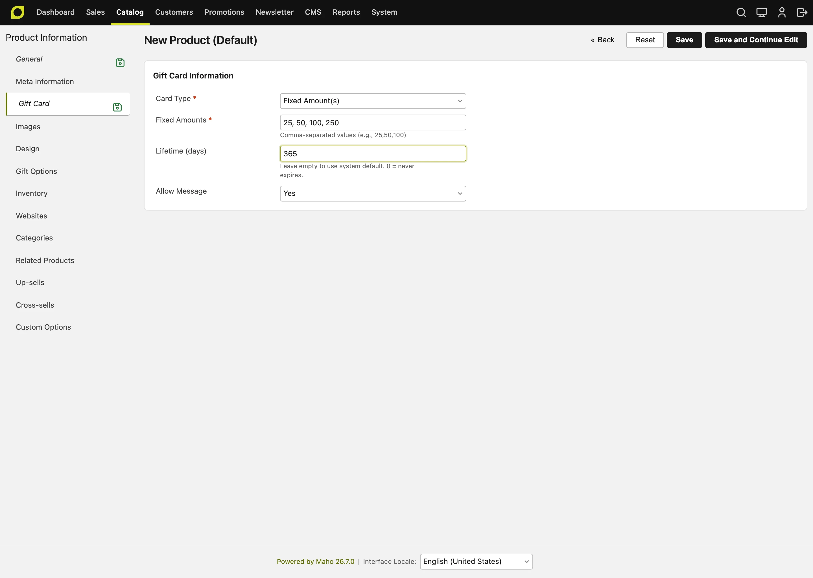

# Gift Cards <span class="version-badge">v26.1+</span>

Maho's built-in Gift Card module provides a complete solution for selling, managing, and redeeming gift cards in your e-commerce store. Gift cards can be purchased as products, sent to recipients via email, and used as payment during checkout.

## Overview

The Gift Card module enables:

- **Selling gift cards** as virtual products with fixed or custom amounts
- **Multi-channel delivery** via email with optional scheduling, QR codes, and barcodes
- **Flexible redemption** at checkout with partial balance support
- **Full order lifecycle integration** including invoices, credit memos, and refunds
- **Complete admin management** with history tracking and batch operations
- **Multi-store and multi-currency support** with automatic currency conversion

## Key Benefits

### For Store Owners
- **Increased revenue** through gift card sales and breakage (unused balances)
- **Customer acquisition** as gift recipients become new customers
- **Cash flow improvement** with upfront payment before redemption
- **Reduced fraud** compared to discount codes through unique, trackable codes

### For Customers
- **Easy gifting** with personalized messages and scheduled delivery
- **Flexible spending** with partial redemption and balance tracking
- **Multiple payment options** by combining gift cards with other payment methods
- **Instant delivery** via email for last-minute gifts

### For Administrators
- **Complete visibility** with audit trails and balance history
- **Bulk operations** for creating, printing, and managing gift cards
- **Automatic expiration** handling via scheduled cron jobs
- **Seamless integration** with existing order and payment workflows

## Configuration

Navigate to **System > Configuration > Sales > Gift Cards** to configure the module.

### General Settings

| Setting | Description | Scope |
|---------|-------------|-------|
| **Enable Gift Cards** | Enable or disable the gift card functionality | Website |
| **Code Length** | Number of characters in generated codes (default: 16) | Global |
| **Code Prefix** | Prefix added to all codes, e.g., "GC" | Global |
| **Default Expiry (days)** | Days until expiration, 0 = never expires | Store View |
| **Refund Expiration Extension (days)** | When refunding to a gift card that is expired or will expire soon, extend expiration by this many days (default: 30). Set to 0 to disable extension. | Store View |
| **Allow Gift Message** | Enable personalized messages on gift cards | Store View |
| **Show QR Code** | Display QR codes on gift cards and emails | Store View |
| **Show Barcode** | Display Code128 barcodes (requires barcode library) | Store View |

### Email Settings

| Setting | Description | Scope |
|---------|-------------|-------|
| **Email Template** | Template used for gift card notifications | Store View |
| **Email Sender** | Store identity used as the sender | Store View |

## Creating Gift Card Products

Gift cards are a special product type that generates redeemable codes when purchased.

### Step 1: Create the Product

1. Go to **Catalog > Manage Products**
2. Click **Add Product**
3. Select **Gift Card** as the product type
4. Complete the standard product information (name, SKU, description, etc.)

### Step 2: Configure Gift Card Options

In the **Gift Card** tab, configure these settings:

<figure markdown="span">

<figcaption>The Gift Card tab of a gift card product in the admin panel</figcaption>
</figure>

#### Amount Type

| Type | Description |
|------|-------------|
| **Fixed Amount(s)** | Customers choose from preset amounts |
| **Custom Amount** | Customers enter any amount within a range |
| **Combined** | Both fixed amounts and custom entry available |

#### Amount Settings

| Setting | Description |
|---------|-------------|
| **Gift Card Amounts** | Comma-separated list of fixed amounts (e.g., "25,50,100,250") |
| **Minimum Amount** | Lowest amount for custom entry |
| **Maximum Amount** | Highest amount for custom entry |

#### Additional Options

| Setting | Description |
|---------|-------------|
| **Allow Gift Message** | Override system setting for this product (Yes/No/Use Config) |
| **Gift Card Lifetime** | Override default expiration for this product (days, 0 = never) |

### Step 3: Set Pricing and Inventory

- **Price**: Set to the minimum available amount (displayed as "From $X")
- **Stock**: Configure inventory quantity as needed
- **Tax Class**: Configure based on your jurisdiction's gift card tax rules

!!! info "Virtual Products"
    Gift cards are virtual products - they don't require shipping and are delivered electronically via email.

## Purchasing Gift Cards (Customer Experience)

### Adding to Cart

When customers view a gift card product, they see:

1. **Amount selection** - Dropdown of fixed amounts or custom entry field
2. **Recipient information** - Name and email for delivery
3. **Sender information** - Name and optional email
4. **Gift message** - Personal message (if enabled)
5. **Delivery date** - Optional scheduled delivery

```
┌─────────────────────────────────────────┐
│  Gift Card Amount: [▼ $50.00        ]   │
│                                         │
│  Recipient Name:   [________________]   │
│  Recipient Email:  [________________]   │
│                                         │
│  Your Name:        [________________]   │
│  Your Email:       [________________]   │
│                                         │
│  Gift Message:                          │
│  [                                  ]   │
│  [                                  ]   │
│                                         │
│  Delivery Date:    [____/____/____]     │
│                                         │
│         [ Add to Cart ]                 │
└─────────────────────────────────────────┘
```

### Cart and Checkout Display

Gift cards appear in the cart with their selected options:

- Amount selected
- Recipient name and email
- Sender name
- Gift message (if provided)
- Scheduled delivery date (if set)

### Gift Card Delivery

After the order is invoiced:

1. **Immediate delivery**: Email sent right away if no delivery date specified
2. **Scheduled delivery**: Email sent on the specified date via cron job

!!! info "Activation vs. Delivery"
    Gift cards are **activated immediately** when the invoice is paid, regardless of the scheduled delivery date. The delivery date only controls when the email is sent - the gift card code is valid and usable as soon as the order is invoiced. The expiration date is also calculated from the activation date, not the delivery date.

Email contents:

- Gift card code
- Current balance
- Sender name and message
- QR code and/or barcode (if enabled)
- Store information and redemption instructions

## Redeeming Gift Cards (Customer Experience)

### Applying at Checkout

Customers can apply gift cards in multiple locations:

#### Cart Page
A gift card entry form appears in the cart totals section:

```
┌─────────────────────────────────────────┐
│  Gift Card Code: [________________]     │
│                  [ Apply ]              │
│                                         │
│  Applied Gift Cards:                    │
│  ✓ GC-XXXX-XXXX-XXXX  $50.00 [Remove]  │
│                                         │
│  Gift Card Total:          -$50.00      │
└─────────────────────────────────────────┘
```

#### Checkout Payment Step
Gift cards can also be applied during the payment step:

```
┌─────────────────────────────────────────┐
│  Have a Gift Card?                      │
│  [________________] [ Apply ]           │
│                                         │
│  Applied:                               │
│  • GC-XX...XXXX: $50.00                │
│                                         │
│  Subtotal:              $175.00         │
│  Gift Card Discount:    -$50.00         │
│  Amount Due:            $125.00         │
└─────────────────────────────────────────┘
```

### Balance Check

Customers can check their gift card balance without applying it:

1. Enter the gift card code
2. Click "Check Balance"
3. View current balance and expiration date

!!! warning "Rate Limiting"
    Balance checks are rate-limited to 10 attempts per minute to prevent code enumeration attacks.

### Check Balance From My Account <span class="version-badge">v26.9+</span>

Logged-in customers also get a **Check Gift Card Balance** page under My
Account. They enter a code and see the remaining balance and the expiration
date, without adding the card to a cart.

The page is deliberately cautious about what it reveals:

- A code that is unknown, expired, disabled, or not valid on the current store
  all produce the same message. This stops the page being used to discover which
  codes exist.
- The result is shown once. Going back in the browser does not redisplay it, so
  a check made on a shared device does not linger.
- The code is never placed in the address bar, so it does not reach browser
  history or server referer logs.
- Failed lookups are limited to 10 per hour, per customer. Successful lookups do
  not count, so a customer holding several cards is not penalised.

This page is separate from the checkout balance check described above, and has
its own limit.

### Partial Redemption

Gift cards support partial redemption:

- If the gift card balance exceeds the order total, only the needed amount is deducted
- Remaining balance stays on the gift card for future use
- Multiple gift cards can be combined on a single order

### Full Coverage

When gift cards fully cover the order total (remaining balance ≤ $0.01):

- The "Free" payment method is automatically activated
- Gift cards work as a pre-payment discount, not a selectable payment method
- No additional payment is required
- Order completes with the free payment method

## Admin Gift Card Management

The admin interface for gift cards is located in the **Sales** menu:

- **Sales > Gift Cards > Manage Gift Cards** - Create, view, edit, and manage individual gift cards
- **Sales > Gift Cards > Gift Card History** - View transaction history for all gift cards

Gift card configuration settings are found at:
- **System > Configuration > Sales > Gift Cards** - Module settings, code format, expiration defaults

Gift card information also appears within order, invoice, and credit memo views when applicable.

### Managing Gift Cards

Navigate to **Sales > Gift Cards > Manage Gift Cards** to access the gift card grid.

#### Grid Columns

| Column | Description |
|--------|-------------|
| **Code** | Unique gift card code (partially masked for security) |
| **Status** | Active, Used, Expired, or Disabled |
| **Websites** | Websites the card is valid on, comma separated <span class="version-badge">v26.9+</span> |
| **Balance** | Current available balance |
| **Initial Balance** | Original amount when created |
| **Expiration Date** | When the gift card expires |
| **Created At** | Creation timestamp |

#### Available Actions

- **View/Edit** - Open gift card details
- **Delete** - Remove gift card permanently
- **Mass Delete** - Delete multiple selected gift cards
- **Mass Status Change** - Change status of multiple gift cards
- **Print PDF** - Generate printable PDF
- **Send Email** - Send or resend notification email

### Creating Gift Cards Manually

Administrators can create gift cards without a purchase:

1. Click **Add New Gift Card**
2. Fill in the details:
   - **Code**: Leave blank for auto-generation or enter custom code
   - **Status**: Set to Active for immediate use
   - **Websites**: Select one or more websites the card is valid on. They must share one base currency <span class="version-badge">v26.9+</span>
   - **Balance**: Enter the gift card value
   - **Recipient/Sender Info**: Optional delivery details
   - **Expiration Date**: Optional expiration
   - **Comment**: Internal note for audit trail

### Editing Gift Cards

Open any gift card from the grid to access the edit form.

#### Form Fields

| Field | Description | Notes |
|-------|-------------|-------|
| **Code** | Unique gift card code | Auto-generated if left blank on creation; cannot be changed after save |
| **Status** | Gift card state | Active, Used, Disabled, or Expired |
| **Websites** | Websites the card is valid on | <span class="version-badge">v26.9+</span> Multiselect, editable after creation. All selected websites must share one base currency, which is shown next to the field |
| **Initial Balance** | Original amount | Display only for existing gift cards (shows historical reference) |
| **Amount / Current Balance** | Gift card value | For new cards: sets initial amount; For existing cards: edit to manually adjust balance. <span class="version-badge">v26.9+</span> Shown to up to 4 decimals, so a balance left over from a partial redemption or a currency conversion is displayed exactly rather than rounded |
| **Expires At** | Expiration date | Optional; leave empty for no expiration |
| **Recipient Name** | Gift recipient name | Optional; used in emails |
| **Recipient Email** | Recipient email address | Optional; required for sending notification emails |
| **Sender Name** | Gift giver name | Optional; shown in emails |
| **Sender Email** | Sender email address | Optional |
| **Message** | Personal gift message | Optional; shown in emails |
| **Admin Comment** | Internal notes | Used to explain balance adjustments (stored in history) |
| **QR Code & Barcode** | Visual codes | Display only for existing gift cards (if enabled in config) |

#### Action Buttons

When viewing an existing gift card, these buttons are available:

- **Save Gift Card** - Save changes and return to grid
- **Delete Gift Card** - Permanently remove the gift card
- **Save and Continue Edit** - Save and stay on the edit page
- **Print PDF** - Generate printable PDF with code, QR code, and barcode
- **Send Email** - Send notification email to recipient (only if recipient email is set)

!!! note "Audit Trail"
    All balance changes create a history entry with the previous balance, new balance, and any comment provided.

### Viewing Gift Card History

Navigate to **Sales > Gift Cards > Gift Card History** to view transaction history for all gift cards.

The history grid shows all gift card transactions across your store. Click any row to jump to that gift card's edit page.

#### History Grid Columns

| Column | Description |
|--------|-------------|
| **ID** | History entry identifier |
| **Gift Card Code** | The gift card this transaction belongs to |
| **Action** | Type of transaction (Created, Used, Adjusted, Refunded, Expired) |
| **Amount** | Transaction amount |
| **Balance Before** | Gift card balance before the transaction |
| **Balance After** | Gift card balance after the transaction |
| **Order** | Related order number (clickable link if applicable) |
| **Recipient Email** | Gift card recipient |
| **Comment** | Transaction notes or reason |
| **Date** | When the transaction occurred |

#### History Entry Types

| Action | Description |
|--------|-------------|
| **Created** | Gift card was generated (from purchase or manually) |
| **Used** | Balance deducted for an order |
| **Refunded** | Balance restored from a credit memo or order cancellation |
| **Adjusted** | Admin manually changed the balance |
| **Expired** | Gift card expired (via cron job) |

#### Transaction History Tab <span class="version-badge">v26.9+</span>

The edit page of a saved gift card has a **Transaction History** tab next to the
General form. It lists the same entries as the grid above, already narrowed to
that card, so you no longer have to leave the card and filter the global
history page to trace where a balance went.

The tab is read-only, pages without reloading the form, and keeps its own
sorting and filtering, so it does not disturb the global history grid. It does
not appear when you are creating a card.

### Printing Gift Cards

Generate printable PDFs for physical delivery:

#### Single Gift Card
1. Open the gift card in edit mode
2. Click **Print PDF** button
3. PDF downloads with code, balance, QR code, and barcode

#### Batch Printing
1. Select multiple gift cards in the grid
2. Choose **Print PDF** from the mass actions dropdown
3. Single PDF downloads with all selected gift cards

### Sending Emails

Trigger gift card notification emails:

#### Immediate Send
1. Open the gift card
2. Click **Send Email**
3. Email sent immediately to the recipient

#### Scheduled Send
1. Open the gift card
2. Set the **Scheduled Email Date**
3. Save the gift card
4. Email will be sent by the cron job at the scheduled time

## Order Integration

### Viewing Gift Cards in Orders

Gift card information appears in several places when viewing orders in the admin panel:

#### Order View Page (Sales > Orders > View Order)

When viewing an order that was paid with gift cards, you'll see:

- **Order Totals Section**: Gift card discount line showing the applied amount
  ```
  Subtotal:                    $175.00
  Shipping & Handling:          $10.00
  Tax:                          $15.00
  Gift Card (GC-XX...XXXX):    -$50.00
  ─────────────────────────────────────
  Grand Total:                 $150.00
  ```

- **Payment Information Section**: Lists the applied gift card codes with amounts
- Multiple gift cards are shown individually if more than one was used

#### Invoice View

Invoices display the gift card amount in the totals section, showing how much of the invoice was covered by gift cards.

#### Credit Memo View

Credit memos show:
- The proportional gift card refund amount in the totals
- "Refund to Gift Card" field when creating the credit memo

### Invoice Processing

When creating an invoice for an order with gift cards:

- Gift card purchases: New gift cards are generated when the invoice is paid
- Gift card payments: The applied amount is shown in invoice totals

### Credit Memo Processing

When creating a credit memo:

#### Orders Paid Partially with Gift Cards
- Refund is proportionally distributed between gift card and other payment methods
- Gift card balance is restored for the gift card portion

#### Orders Fully Paid with Gift Cards
- Enter the refund amount in the **Refund to Gift Card** field
- Amount is added back to the customer's gift card balance
- Gift card status changes from "Used" back to "Active" if applicable

#### Expiration Handling on Refunds
When refunding to a gift card, the system automatically extends the expiration date if needed:

- If the gift card is **expired** or will expire within the configured extension period, the expiration is extended
- The extension ensures the customer has at least the configured number of days (default: 30) to use the refunded balance
- Gift cards with more time remaining than the extension period keep their original expiration date
- The extension is recorded in the gift card history for audit purposes

!!! example "Example"
    A gift card expires in 10 days. The "Refund Expiration Extension" is set to 30 days. When a refund is processed:

    - The balance is restored to the gift card
    - The expiration is extended to 30 days from now (not just 10)
    - History records: "Refund for order #123 (expiration extended to 30 days from now)"

```
┌─────────────────────────────────────────┐
│  Credit Memo Totals                     │
│                                         │
│  Subtotal:                    $100.00   │
│  Refund to Gift Card:        [$50.00]   │
│  Refund to Store Credit:     [$50.00]   │
│                                         │
│  Grand Total:                 $100.00   │
└─────────────────────────────────────────┘
```

### Order Cancellation

When an order paid with gift cards is canceled:

- Gift card balance is automatically restored for the full amount
- Gift card status changes from "Used" back to "Active" (if applicable)
- Expiration handling follows the same rules as credit memo refunds:
  - If the gift card is expired or will expire within the configured extension period, the expiration is extended
  - The extension ensures the customer has at least the configured number of days (default: 30) to use the restored balance
  - Gift cards with more time remaining keep their original expiration date
- History entry is created documenting the cancellation and any expiration extension

!!! note "Automatic Refund"
    Gift card refunds on order cancellation are automatic. There's no need to create a credit memo - the balance is restored immediately when the order is canceled.

### Admin Order Creation

When creating orders in the admin panel:

1. Add products to the order
2. In the **Gift Card** section, enter a code and click **Apply**
3. Gift card discount appears in order totals
4. Complete the order with remaining balance via other payment method

## Multi-Store and Multi-Currency

### Website Binding <span class="version-badge">v26.9+</span>

- A gift card is associated with one or more websites, chosen on creation and
  editable afterwards
- A gift card can only be redeemed on a website it is associated with, which
  prevents cross-website balance exploitation
- All associated websites must share one base currency, because the balance is
  denominated in it. This also means re-scoping a card never changes what its
  balance is worth
- Deleting a website removes it from every card that referenced it. A card left
  with no websites cannot be redeemed anywhere, but it still opens in the admin
  so you can associate it with another website

!!! info "Upgrading from an earlier version"
    Before v26.9 a card was assigned to exactly one website, permanently. The
    upgrade moves that assignment into the new structure unchanged, so no card
    gains or loses reach. Widening a card to more websites is a deliberate edit.

### Currency Handling

Gift cards support multi-currency environments:

| Scenario | Behavior |
|----------|----------|
| **Storage** | Balances stored in the base currency shared by the card's websites |
| **Display** | Converted to store view currency for display |
| **Redemption** | Converted using current exchange rates |
| **Refunds** | Returned in base currency |

**Example:**

- Gift card created on US website: $100.00 USD (base currency)
- Viewed in UK store view: £79.00 GBP (at current exchange rate)
- Customer redeems £50.00 GBP worth
- Balance reduced by equivalent USD amount
- Remaining balance: ~$37.00 USD

!!! tip "Exchange Rates"
    Ensure your currency exchange rates are up to date for accurate gift card conversions across currencies.

## Barcode Support

The module supports Code128 barcodes when the optional barcode library is installed.

### Installation

Add the barcode package to your project:

```bash
composer require picqer/php-barcode-generator
```

### Configuration

1. Enable barcodes in **System > Configuration > Sales > Gift Cards > Show Barcode**
2. Barcodes will appear on gift cards in emails and PDFs

!!! note "Library Detection"
    The module automatically detects if the barcode library is installed. If not installed, the barcode option is hidden in configuration.

## Gift Card Lifecycle

Understanding how gift cards move through different states:

### Statuses

| Status | Description |
|--------|-------------|
| **Active** | Can be used for purchases |
| **Used** | Balance is zero, fully consumed |
| **Expired** | Past expiration date, no longer valid |
| **Disabled** | Manually disabled by admin |

### Lifecycle Flow

```
Purchase → Invoice Paid → Gift Card Created (Active)
                              ↓
                    Customer Redeems (partial)
                              ↓
                    Balance Reduced (still Active)
                              ↓
              ┌───────────────┴───────────────┐
              ↓                               ↓
    Fully Redeemed (Used)           Expires (Expired)
              ↓
    Credit Memo → Refund (Active again)
```

### Automatic Expiration

A daily cron job (runs at 1 AM) automatically:

- Finds all active gift cards past their expiration date
- Changes their status to "Expired"
- Records the expiration in history

## Troubleshooting

### Gift Card Not Applying

**Problem:** Customer cannot apply a gift card code.

**Possible causes:**

- Code is incorrect or has typos
- Gift card is not associated with the current website
- Gift card status is not "Active"
- Gift card has expired
- Gift card balance is zero
- Cart contains only gift card products (circular purchase prevention)

**Solution:** Check the gift card in admin to verify status, websites, balance, and expiration.

### Gift Cards Not Created After Purchase

**Problem:** Customer purchased gift cards but codes weren't generated.

**Possible causes:**

- Order not yet invoiced
- Invoice not yet paid
- Cron jobs not running

**Solution:**

1. Verify the order has been invoiced
2. Check invoice payment status
3. Confirm the scheduled cron jobs are running (gift cards are generated when the invoice is paid)

??? note "For developers / advanced"

    Gift card generation is triggered by Maho's cron. To run the queue manually and confirm cron is working, use the Maho CLI:

    ```bash
    ./maho cron:run
    ```

### Emails Not Sending

**Problem:** Gift card notification emails are not being delivered.

**Possible causes:**

- No recipient email on gift card
- Email scheduled for future delivery
- Email queue not processing
- SMTP configuration issues

**Solution:**

1. Check gift card has recipient email set
2. Check `email_scheduled_at` vs `email_sent_at` timestamps
3. Verify email cron job is running (every 5 minutes)
4. Check email logs for delivery errors

### Balance Conversion Issues

**Problem:** Gift card balance appears incorrect in different currencies.

**Possible causes:**

- Exchange rates not configured
- Exchange rates out of date

**Solution:**

1. Go to **System > Currency > Rates**
2. Import current exchange rates
3. Verify rates are correct for your currencies

### Gift Card Discount Not Applying

**Problem:** Gift card discount doesn't appear in order totals.

**Possible causes:**

- Gift card code not applied correctly
- Gift card module disabled
- Gift card not associated with the current website

**Solution:**

1. Verify the gift card code was successfully applied in cart or checkout
2. Check that applied gift cards appear in the order totals section
3. For full coverage orders (≤ $0.01 remaining), the "Free" payment method should be available
4. Verify the gift card module is enabled in configuration

## Best Practices

### Security

- **Never display full codes** in admin grids or customer-facing areas (use masked display)
- **Enable rate limiting** to prevent code enumeration attacks
- **Regularly audit** gift card history for suspicious activity
- **Set reasonable expiration dates** to manage liability

### Operations

- **Monitor breakage** (unused balances) as a business metric
- **Set up alerts** for high-value gift card transactions
- **Regular reconciliation** of gift card balances vs. revenue
- **Document manual adjustments** with clear comments

### Customer Experience

- **Clear redemption instructions** in gift card emails
- **Balance visibility** on account dashboard
- **Multiple redemption options** (cart page, checkout, account)
- **Prompt delivery** of gift card emails

## Further Reading

- [Gift Cards Developer Guide](../developer/guide/gift-cards.md) - Technical reference for developers
- [Email Automation](email-automation.md)
- [Product Types](product-types.md)
