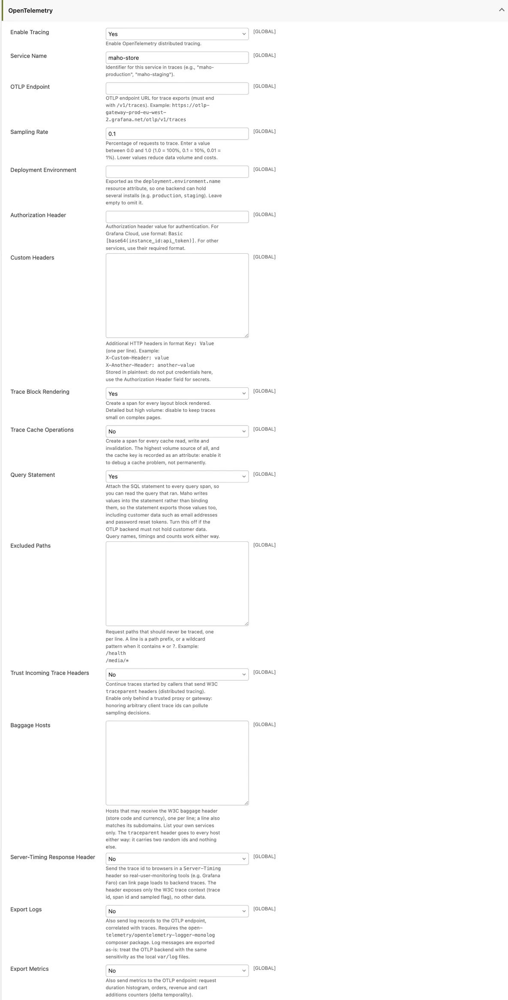

# OpenTelemetry <span class="version-badge">v26.9+</span>

Maho ships native [OpenTelemetry](https://opentelemetry.io){target=_blank} instrumentation:
distributed traces, optional metric and log export, commerce-level span events, and W3C trace
context propagation, all over OTLP/HTTP.

OTLP is the vendor-neutral standard, so Maho works with any observability backend that ingests it:
Grafana Cloud (Tempo/Loki/Mimir), Sentry, Datadog, New Relic, Honeycomb, Elastic APM, Dynatrace,
Jaeger, SigNoz, Axiom, Better Stack, or a self-hosted
[OpenTelemetry Collector](https://opentelemetry.io/docs/collector/){target=_blank}. There is no
vendor-specific code and no extra module per vendor: point the endpoint at your backend and go.

Everything is **off by default**. When tracing is disabled, `Mage::getTracer()` returns `null` and
every instrumentation point is a no-op, so a store that does not use OpenTelemetry pays nothing.

## Installation

The OpenTelemetry SDK is an optional dependency. Install it on any environment that should export
telemetry:

```bash
composer require open-telemetry/sdk open-telemetry/exporter-otlp nyholm/psr7
```

`nyholm/psr7` provides the PSR-17 HTTP factories the OTLP transport discovers at runtime (any
`psr/http-factory-implementation` works).

Two more packages are needed only for specific features:

```bash
# Log export (the Export Logs setting)
composer require open-telemetry/opentelemetry-logger-monolog

# B3 propagation, only when OTEL_PROPAGATORS names b3 or b3multi
composer require open-telemetry/extension-propagator-b3
```

If you enable tracing without the SDK installed, Maho logs a warning to `var/log/system.log` and
keeps running untraced (see [Troubleshooting](#troubleshooting)).

## Quick start

Admin configuration lives under **System > Configuration > Advanced > Developer > OpenTelemetry**.
Three fields are enough to start; every other setting has a working default:

1. **Enable Tracing**: Yes
2. **OTLP Endpoint**: the trace ingest URL of your backend, ending in `/v1/traces`.
   For Grafana Cloud: `https://otlp-gateway-prod-eu-west-2.grafana.net/otlp/v1/traces`
3. **Authorization Header**: the credential your backend expects.
   For Grafana Cloud: `Basic [base64(instance_id:api_token)]`

Traces start flowing on the next request. The default sampling rate is `0.1` (10% of requests),
so on a quiet development store either raise it to `1.0` or refresh a page a few times.

For local development, a single container gives you a full backend (Grafana + Tempo + Loki +
Mimir + an OTLP receiver on port 4318):

```bash
docker run -p 3000:3000 -p 4318:4318 grafana/otel-lgtm
```

Point the OTLP Endpoint at `http://localhost:4318/v1/traces` and browse traces at
`http://localhost:3000` (Explore > Tempo).

## What gets traced

One server span is created per request, then everything that happens inside it nests underneath:

| Span | Kind | Notes |
|---|---|---|
| `{METHOD} {module/controller/action}` | SERVER | Request root span for storefront and admin pages, renamed after routing so trace lists group by route |
| `{METHOD} {api_route}` | SERVER | Same for `/api/*` (REST, GraphQL, MCP): the API Platform route name, or `api/{type}` for the legacy SOAP/XML-RPC servers |
| `{OPERATION} {table}` | CLIENT | Every database query. `db.query.text` carries the statement as executed (see [Data safety](#data-safety)) and can be switched off |
| `{METHOD}` (HTTP client) | CLIENT | Outgoing requests through `\Maho\Http\Client::create()`. `url.full` is stripped of query string, fragment and userinfo. The span covers the whole exchange, from the request being issued to the body being read |
| `process {MessageClass}` | CONSUMER | One span per queue message, continuing the trace of the request that dispatched it. The payload is never recorded |
| `BLOCK:*`, `OBSERVER:*`, `cron.job*`, `email.send`, `image.process`, `index.reindex`, `payment.*` | INTERNAL | High-level profiler timers promoted to spans |
| `cache.*` | INTERNAL | Cache reads, writes and invalidations. Off by default |
| `maho {command}` | INTERNAL | Each CLI command is its own trace. Only the command name is recorded, never the arguments |

Nothing is traced until the request root span opens, so bootstrap work does not produce a scatter
of single-span traces.

The root span also carries `maho.store_id`, `maho.store_code`, `maho.website_id`, `maho.area`
(`frontend`, `admin` or `api`), `http.route` and `http.response.status_code`. Signed-in customers
and admin users tag the trace with the pseudonymous `enduser.id` (the numeric id, never name or
email).

### Commerce span events

Business moments are recorded as span events on the active trace, with `maho.*` attributes and no
PII:

| Event | Fires on | Attributes |
|---|---|---|
| `maho.order.placed` | `sales_order_place_after` | `maho.order.increment_id`, `maho.order.grand_total`, `maho.order.currency`, `maho.order.items_count`, `maho.payment.method` |
| `maho.cart.add` | `checkout_cart_product_add_after` | `maho.product.id`, `maho.product.sku` |
| `maho.checkout.success` | checkout success page | `maho.order.ids` |
| `maho.customer.login` | `customer_login` | none (sets `enduser.id` on the root span) |

## Configuration reference

All settings live under **System > Configuration > Advanced > Developer > OpenTelemetry** and
depend on **Enable Tracing** being set to Yes.



### Connection

| Setting | Default | Description |
|---|---|---|
| Enable Tracing | No | Master switch for the admin-driven configuration |
| Service Name | `maho-store` | The `service.name` resource attribute, e.g. `maho-production` |
| OTLP Endpoint | empty | Trace ingest URL, must end with `/v1/traces`. The logs and metrics endpoints are derived from it by swapping the signal segment |
| Deployment Environment | empty | Exported as `deployment.environment.name` (e.g. `production`, `staging`) so one backend can hold several installs. Empty omits it |
| Authorization Header | empty | Value of the `Authorization` header sent to the endpoint. Stored encrypted in the database |
| Custom Headers | empty | Extra headers, one `Key: Value` per line. Stored in plaintext: keep credentials in the Authorization Header field |

### Detail and volume dials

| Setting | Default | Description |
|---|---|---|
| Sampling Rate | `0.1` | Fraction of requests to trace, `0.0` to `1.0`. Applied parent-based: a request continuing a sampled trace stays sampled |
| Trace Block Rendering | Yes | A span for every layout block rendered. Detailed but high volume: disable it to keep traces small on complex pages |
| Trace Cache Operations | No | A span for every cache read, write and invalidation. The highest-volume source of all, and the cache key is recorded as an attribute: enable it to debug a cache problem, not permanently |
| Query Statement | Yes | Attach the SQL statement to every query span as `db.query.text`. See [Data safety](#data-safety) |
| Excluded Paths | empty | Request paths that are never traced, one per line. A line is a path prefix, or a wildcard pattern when it contains `*` or `?` (e.g. `/health`, `/media/*`) |
| Export Logs | No | Also ship Monolog records to the OTLP endpoint. See [Log export](#log-export) |
| Export Metrics | No | Also ship metrics to the OTLP endpoint. See [Metrics](#metrics) |

### Propagation and safety

| Setting | Default | Description |
|---|---|---|
| Baggage Hosts | empty | Hosts allowed to receive the W3C `baggage` header (store code and currency), one per line; a line also matches its subdomains. List your own services only |
| Trust Incoming Trace Headers | No | Continue traces started by callers that send `traceparent` headers. Enable only behind a trusted proxy or gateway |
| Server-Timing Response Header | No | Expose the trace context to browsers for RUM correlation. See [Browser RUM](#browser-rum-server-timing) |

## Environment variables

Maho honors the standard `OTEL_*` environment variables, so 12-factor deployments can configure
everything through the environment and leave the admin fields empty.

| Variable | Effect |
|---|---|
| `OTEL_SDK_DISABLED=true` | Disables everything, wins over all other settings |
| `OTEL_SERVICE_NAME` | Service name, overrides the admin field |
| `OTEL_RESOURCE_ATTRIBUTES` | Extra resource attributes, e.g. `deployment.environment.name=staging` |
| `OTEL_EXPORTER_OTLP_ENDPOINT` | Base OTLP URL; `/v1/{signal}` is appended per signal |
| `OTEL_EXPORTER_OTLP_TRACES_ENDPOINT`, `_LOGS_ENDPOINT`, `_METRICS_ENDPOINT` | Per-signal URL, used verbatim |
| `OTEL_EXPORTER_OTLP_HEADERS` | `key=value,key2=value2`, merged over the admin headers key by key |
| `OTEL_EXPORTER_OTLP_PROTOCOL` | `http/protobuf` (default), `http/json` or `http/ndjson`; also per-signal `_TRACES_` / `_LOGS_` / `_METRICS_` variants. `grpc` is not supported and falls back to `http/protobuf` with a warning. Environment only, there is no admin field |
| `OTEL_PROPAGATORS` | Which context headers are read and written; default `tracecontext,baggage`. `b3` / `b3multi` need `open-telemetry/extension-propagator-b3` |
| `OTEL_TRACES_SAMPLER` | `always_on`, `always_off`, `traceidratio`, `parentbased_*`; overrides the admin Sampling Rate |
| `OTEL_TRACES_SAMPLER_ARG` | Ratio for the `traceidratio` samplers |
| `OTEL_LOGS_EXPORTER`, `OTEL_METRICS_EXPORTER` | `otlp` or `none`, override the admin Export Logs / Export Metrics flags |
| `OTEL_SPAN_ATTRIBUTE_VALUE_LENGTH_LIMIT` | Truncates long attribute values (a big `db.query.text`); unlimited by default |
| `OTEL_BSP_MAX_QUEUE_SIZE`, `OTEL_BSP_SCHEDULE_DELAY`, `OTEL_BSP_EXPORT_TIMEOUT`, `OTEL_BSP_MAX_EXPORT_BATCH_SIZE` | Batch span processor tuning |

### Precedence

The activation check runs in this order:

1. `OTEL_SDK_DISABLED=true` disables everything, no matter what else is set.
2. The admin **Enable Tracing** flag enables tracing.
3. Otherwise, the mere presence of `OTEL_EXPORTER_OTLP_ENDPOINT` or
   `OTEL_EXPORTER_OTLP_TRACES_ENDPOINT` enables tracing.

!!! warning "Endpoint env vars activate tracing"
    Setting `OTEL_EXPORTER_OTLP_ENDPOINT` turns tracing on even when the admin flag is No. This
    is intentional: environment-driven deployments never touch the admin. Unset the variable, or
    set `OTEL_SDK_DISABLED=true`, to stop exporting.

For individual settings, the environment always wins over the admin field: `OTEL_SERVICE_NAME`
replaces the Service Name, the endpoint variables replace the OTLP Endpoint,
`OTEL_TRACES_SAMPLER` replaces the Sampling Rate, and `OTEL_EXPORTER_OTLP_HEADERS` is merged over
the admin headers key by key. `OTEL_LOGS_EXPORTER` / `OTEL_METRICS_EXPORTER` override the two
export flags in both directions (`otlp` forces on, `none` forces off).

## Metrics

**Export Metrics** ships delta-temporality metrics to `/v1/metrics` (deltas because PHP processes
are short-lived; the backend aggregates them):

| Metric | Type | Attributes |
|---|---|---|
| `http.server.request.duration` | histogram (seconds) | `http.request.method`, `http.response.status_code` |
| `maho.orders` | counter | `maho.order.currency`, `maho.payment.method` |
| `maho.order.revenue` | counter | `maho.order.currency` |
| `maho.cart.additions` | counter | none |

## Log export

**Export Logs** ships every Monolog record to `/v1/logs`. It requires the
`open-telemetry/opentelemetry-logger-monolog` package. Whenever tracing is active, log records
already carry `trace_id` and `span_id`, so the backend can jump from a log line to the trace it
belongs to, and back.

!!! warning "Logs leave the server as-is"
    Records are exported verbatim, at the same level as the local files: whatever any module
    (including third-party code) writes to the logs leaves the server. Enable this only against a
    backend you trust with the contents of `var/log`.

## Data safety

The trace instrumentation never exports:

- HTTP request or response headers or bodies
- URL query strings or userinfo
- CLI command arguments
- Queue message payloads
- Warning/notice-level PHP error messages (only fatal-class errors include the message text)

Signed-in customers and admin users are identified by numeric id alone (`enduser.id`), never by
name or email. The Authorization Header for the OTLP endpoint itself is stored encrypted.

A failed span carries the exception class in `error.type` and in its status description, never the
message. The `exception` span event that accompanies an unhandled failure is the standard
OpenTelemetry one, so it does carry `exception.message` and `exception.stacktrace`: treat the
backend as holding whatever your code puts in exception messages.

Two settings deliberately export more, and both are named for what they do:

!!! danger "Query Statement (on by default)"
    Puts the SQL statement on every query span. Maho writes values into the statement with
    `quoteInto()` rather than binding them, so the statement carries those values: customer email
    addresses, password reset tokens, search terms, coupon codes. Turn it off if the OTLP backend
    must not hold customer data. Span names, timings and counts are unaffected.

!!! danger "Export Logs (off by default)"
    Ships Monolog records verbatim, so anything any module logs leaves the server. Enable it only
    against a backend you trust with the contents of `var/log`.

## Sampling and cost control

Span volume is bounded by sampling, not by a per-trace cap. On an unsampled request no span is
built at all, so no attribute is even computed. On a sampled request every operation is recorded:
a page that runs 3000 queries produces 3000 spans. The intended tuning is:

- **Lower the Sampling Rate** rather than trimming what a trace contains. `0.1` (the default) or
  `0.01` is plenty for a busy production store; complete traces at a low rate beat truncated
  traces at a high one.
- **Raise `OTEL_BSP_MAX_QUEUE_SIZE`** above the default 2048 if very large traces drop spans.
- **Disable Trace Block Rendering** on stores with complex layouts if block spans dominate.
- **Leave Trace Cache Operations off** except while debugging a cache problem.
- **Use Excluded Paths** for health checks and other high-frequency, low-value endpoints.

Telemetry is flushed after the response has been sent to the client, so page latency is
unaffected. Each enabled signal (traces, logs, metrics) flushes sequentially though, so extra
signals lengthen the worst-case time a PHP worker is held when the collector is slow or down.
`OTEL_BSP_EXPORT_TIMEOUT` and the transport timeout (10 seconds, a single retry) bound it.

## Distributed tracing

### Outgoing requests

Every outgoing request through `\Maho\Http\Client::create()` carries a `traceparent` header, to
every host: it contains two random ids and a sampled flag, nothing else. The `baggage` header
(`maho.store`, `maho.currency`) only goes to hosts listed under **Baggage Hosts**, so a payment
gateway or a shipping carrier never receives it. A listed host also matches its subdomains.

### Queue messages

Dispatching a queue message stores the current W3C trace context on the message row, so the
handler's consumer span joins the trace of the request that queued the work, even though that
request is normally long finished when the handler runs. Sampling follows the dispatching request:
work queued by an unsampled request is not traced either.

### Incoming requests

**Trust Incoming Trace Headers** (default off) continues traces started by upstream callers that
send `traceparent` headers, and sampling then honors the parent's decision (parent-based
sampling). Which headers are read depends on `OTEL_PROPAGATORS`, so a caller sending B3 can be
joined once `open-telemetry/extension-propagator-b3` is installed. Only enable this behind a
trusted proxy or gateway: honoring arbitrary client trace ids can pollute sampling decisions.

### Browser RUM (Server-Timing)

**Server-Timing Response Header** (default off) sends the trace id to browsers in a
`Server-Timing` header, so real-user-monitoring tools (e.g. Grafana Faro) can link page loads to
backend traces. The header exposes only the W3C trace context (trace id, span id and sampled
flag), no other data.

## Custom spans in your code

Modules can add their own spans and attributes. Every call is null-safe and becomes a no-op when
tracing is disabled or the request was not sampled:

```php
$span = Mage::getTracer()?->startSpan('erp.sync', ['erp.entity' => 'product']);
try {
    // ... the work ...
    $span?->setAttribute('erp.items', $count);
} catch (\Throwable $e) {
    $span?->recordException($e);
    throw $e;
} finally {
    $span?->end();
}

// Shorthand for the same startSpan() call
$span = Mage::startSpan('erp.sync');

// Annotate whatever span is currently active
Mage::getTracer()?->getActiveSpan()?->addEvent('erp.batch.done', ['erp.batch' => $batchId]);
```

The span object also offers `setAttributes()`, `setStatus()`, `updateName()`, `getTraceId()`,
`getSpanId()` and `isRecording()`. On hot paths, check
`Mage::getTracer()?->isRecording()` before computing expensive attributes.

Profiler timers are another entry point: `\Maho\Profiler::start('my.timer')` /
`\Maho\Profiler::stop('my.timer')` become spans automatically when the timer name matches one of
the instrumented prefixes (`OBSERVER:`, `BLOCK:`, `cron.job`, `email.send`, `image.process`,
`index.reindex`, `payment.`, `cache.`).

## Troubleshooting

**"OpenTelemetry SDK not installed" in `system.log`.** Tracing is enabled but the SDK packages
are missing. Run
`composer require open-telemetry/sdk open-telemetry/exporter-otlp nyholm/psr7`. Maho keeps
serving requests untraced until then.

**"OpenTelemetry enabled but no endpoint configured" in `system.log`.** Enable Tracing is Yes but
the OTLP Endpoint field and the endpoint environment variables are all empty.

**No traces arrive.** Check the sampling rate first (default `0.1`: only 1 request in 10 is
traced). Then confirm the endpoint ends with `/v1/traces` and the Authorization Header matches
what the backend expects. On successful initialization Maho logs
"OpenTelemetry tracer initialized successfully" at INFO level.

**The collector is down.** Requests keep working: the export runs after the response has been
sent, fails after a 10-second timeout and a single retry, and logs the failure. The spans of that
request are lost, and the PHP worker is held for the duration of the failed export, so do not
point production at a collector that is frequently unreachable.

**"OTLP over gRPC is not supported" in `system.log`.** `OTEL_EXPORTER_OTLP_PROTOCOL` names
`grpc`. Maho exports over OTLP/HTTP only and falls back to `http/protobuf`.

**Config changes do not seem to apply.** The tracer initializes once per request and caches its
decision, so a change takes effect on the next request. Flush the configuration cache after
changing the settings, as with any store configuration.
