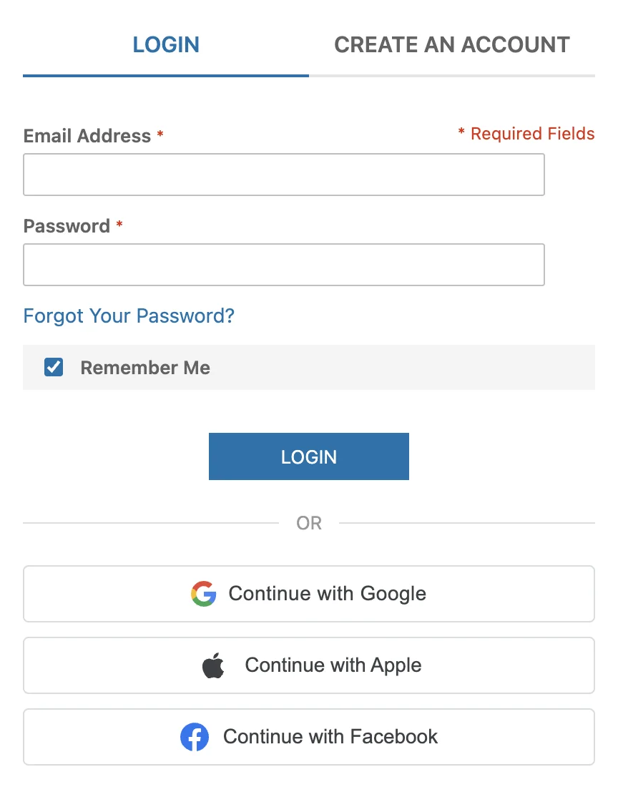
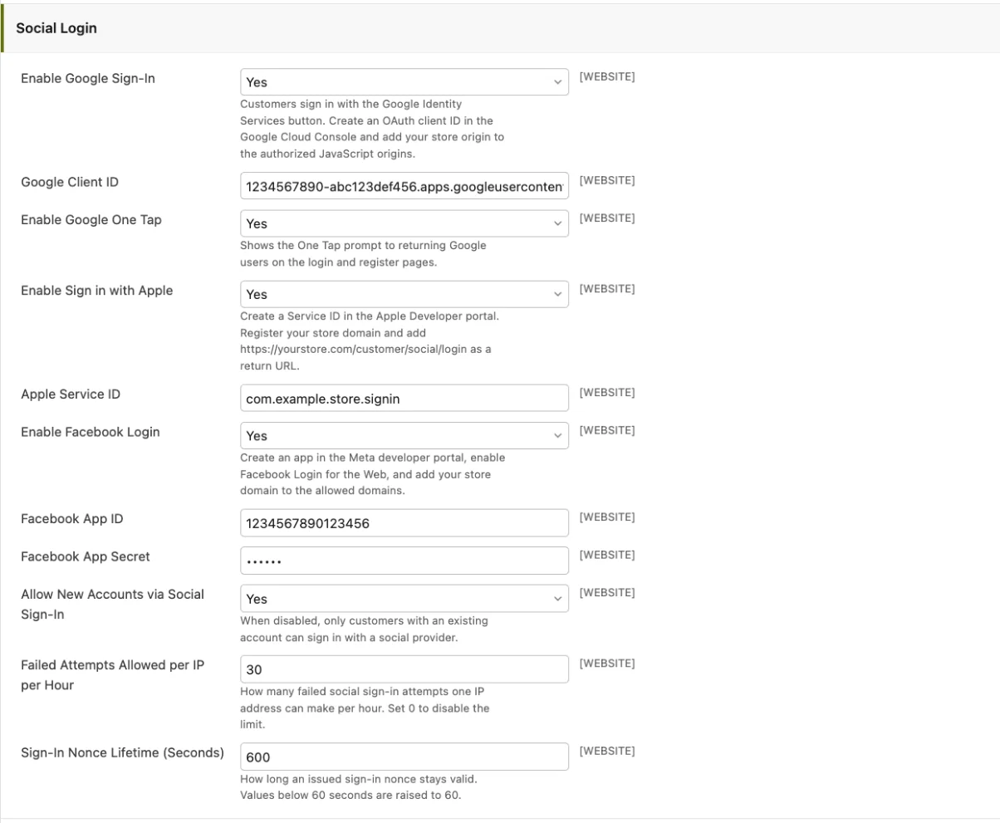

# Social Login <span class="version-badge">v26.9+</span>

Social Login lets customers sign in with an account they already have: Google, Apple, or Facebook. The buttons appear on the login and registration pages, under the standard form.



## Key Features

- **Three providers** - Google (with optional One Tap), Sign in with Apple, and Facebook Login
- **Automatic account creation** - A first-time social sign-in creates a customer account, no form needed
- **Automatic linking** - A social identity with a verified email links to the existing account with that email
- **Connected Accounts page** - Customers see and unlink their providers under My Account
- **2FA aware** - Customers with two-factor authentication still complete their 2FA challenge
- **Rate limiting** - Failed attempts are limited per IP address
- **Multi-website support** - Every setting can differ per website

## Configuration

Go to **System → Configuration → Customers → Customer Configuration → Social Login**.



| Setting | Description | Default |
|---------|-------------|---------|
| **Enable Google Sign-In** | Show the Google button | Disabled |
| **Google Client ID** | OAuth client ID from the Google Cloud Console | - |
| **Enable Google One Tap** | Show the One Tap prompt to returning Google users | Disabled |
| **Enable Sign in with Apple** | Show the Apple button | Disabled |
| **Apple Service ID** | Services ID from the Apple Developer portal | - |
| **Enable Facebook Login** | Show the Facebook button | Disabled |
| **Facebook App ID** | App ID from the Meta developer portal | - |
| **Facebook App Secret** | App secret, stored encrypted | - |
| **Allow New Accounts via Social Sign-In** | When disabled, only existing customers can sign in with a provider | Enabled |
| **Failed Attempts Allowed per IP per Hour** | Rate limit for failed sign-in attempts, 0 disables it | 30 |
| **Sign-In Nonce Lifetime (Seconds)** | How long an issued sign-in nonce stays valid | 600 |

A provider button appears only when the provider is enabled **and** its credentials are filled in.

## Provider Setup

### Google

1. Create a project in the [Google Cloud Console](https://console.cloud.google.com).
2. Configure the OAuth consent screen under **APIs & Services**.
3. Create an **OAuth client ID** of type "Web application" under **APIs & Services → Credentials**.
4. Add your store origin (for example `https://yourstore.com`) to **Authorized JavaScript origins**.
5. Copy the client ID into **Google Client ID** in the Maho admin.

No client secret is needed. Maho verifies the Google ID token by signature against Google's published public keys.

### Apple

1. Sign in to the [Apple Developer portal](https://developer.apple.com). A paid membership is required.
2. Create an **App ID** with the "Sign in with Apple" capability under **Certificates, Identifiers & Profiles**.
3. Create a **Services ID** and enable "Sign in with Apple" on it.
4. In the Services ID configuration, register your store domain and add `https://yourstore.com/customer/social/login` as a return URL.
5. Copy the Services ID into **Apple Service ID** in the Maho admin.

!!! note
    Apple requires a publicly reachable HTTPS domain. Local hostnames do not work.

### Facebook

1. Create an app in the [Meta developer portal](https://developers.facebook.com) with the "Authenticate and request data from users with Facebook Login" use case.
2. Add the **Facebook Login** product and enable it for the Web.
3. Add your store domain to the app domains and to the Facebook Login allowed domains.
4. Copy the App ID and App Secret from **App settings → Basic** into the Maho admin.

While the Meta app is in development mode, only accounts with a role on the app can sign in. Switch the app to live mode before you launch. Maho sends `appsecret_proof` on its server-side calls, so the recommended **Require App Secret** setting can stay on.

## How It Works

1. The customer clicks a provider button and authenticates with the provider.
2. The provider returns a signed token to the browser, and the browser posts it to Maho.
3. Maho verifies the token signature, audience, and expiry on the server.
4. Maho finds the matching customer and logs the customer in.

The match in step 4 follows this order:

- A previously linked identity signs the customer straight in.
- Otherwise, a provider-verified email that matches an existing account links the identity to that account.
- Otherwise, Maho creates a new account with the name and email from the provider.

If the registration form has required fields beyond name and email, a new customer is sent to the account edit page to complete them. If **Allow New Accounts via Social Sign-In** is disabled, unknown customers get an error instead of a new account.

Customers with two-factor authentication enabled complete their 2FA challenge before the session starts.

## Connected Accounts

Customers manage their linked providers on **My Account → Connected Accounts**. Each linked provider shows with an **Unlink** button. Unlinking is always allowed: password login, password reset, and [Magic Link](magic-link-authentication.md) keep the account reachable by email.

Administrators see the same list on the **Social Login** tab of the customer edit page.

## Security Notes

- Provider tokens are verified server-side: signature, issuer, audience, and expiry.
- Google and Apple sign-ins carry a one-time nonce, so a captured token cannot be replayed.
- The Facebook app secret is stored encrypted in the database.
- Failed attempts are rate-limited per IP address.
- A social sign-in with a provider-verified email also clears a pending "confirm your email" state, because the provider proved ownership of the address.

## REST API

Headless storefronts exchange a provider credential for a Maho customer JWT:

```
POST /api/customers/social-auth
```

```json
{
  "provider": "google",
  "providerToken": "<ID token or access token>",
  "nonce": "<nonce passed to the provider SDK>",
  "cartId": "<optional guest cart masked ID to merge>"
}
```

The response contains the JWT (`token`, `token_type`, `expires_in`), the customer info, and the customer cart. Customers with 2FA enabled must also send `twofaCode`.
