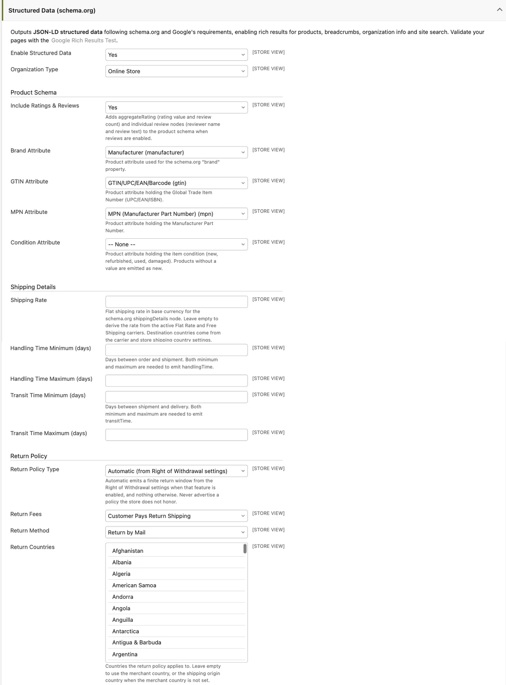

# Structured Data v26.7+

Maho emits **schema.org structured data (JSON-LD)** into your storefront pages: products,
breadcrumbs, organization info, site search, and blog posts. This markup is what makes your
store eligible for **rich results** in Google Search, powers **Google Merchant listings**
(price, availability, shipping and returns shown directly in search), and is read by AI
assistants and shopping surfaces when they present your products.

The module is **enabled by default** and works with no configuration. The settings on this
page make the product markup complete: with them in place, Google can show your price,
availability, shipping cost and return policy without a Merchant Center feed, and validate
your feed against your pages when you have one.

As of **v26.9** the product markup covers Google's full core product set: seller, item
condition, price validity, shipping details, return policy, and variant markup for
configurable products.

## Where everything lives

The module settings sit in **System > Configuration > Catalog > Catalog > Structured Data
(schema.org)**:

| Field | Default | What it does |
|---|---|---|
| Enable Structured Data | Yes | Master switch for all JSON-LD output. |
| Organization Type | Online Store | The schema.org type of your organization node. |
| Include Ratings & Reviews | Yes | Adds aggregateRating and review nodes to the product schema. |
| Brand Attribute | manufacturer | Product attribute used for `brand`. |
| GTIN Attribute | gtin | Product attribute holding the UPC/EAN/ISBN. |
| MPN Attribute | mpn | Product attribute holding the Manufacturer Part Number. |
| Condition Attribute v26.9+ | (none) | Product attribute holding the item condition. Products without a value are emitted as new. |
| Shipping Rate v26.9+ | (empty) | Manual flat shipping rate override, in base currency. Empty derives the rate from your carriers. |
| Handling Time Minimum / Maximum (days) v26.9+ | (empty) | Days between order and shipment. Both are needed to emit handling time. |
| Transit Time Minimum / Maximum (days) v26.9+ | (empty) | Days between shipment and delivery. Both are needed to emit transit time. |
| Return Policy Type v26.9+ | Automatic | How the return policy is built (see below). |
| Return Window (days) v26.9+ | 14 | The window, when the type is Finite Return Window. |
| Return Fees v26.9+ | Customer Pays Return Shipping | Who pays return shipping. |
| Return Method v26.9+ | Return by Mail | How customers return items. |
| Return Countries v26.9+ | (empty) | Countries the policy applies to. Empty derives them (see below). |

The markup also reads settings you have probably already configured elsewhere. Check these,
because they directly shape what is emitted:

| Setting | Location | Feeds into |
|---|---|---|
| Display Product Prices In Catalog | Sales > Tax > Price Display Settings | Whether emitted prices include tax (they follow the page). |
| Store Name | General > General > Store Information | The `seller` and organization name. |
| Country (merchant country) | General > General > Store Information | Return policy country fallback. |
| Allowed Shipping Countries | General > General > Countries Options | Shipping destination and return policy countries. |
| Origin > Country | Sales > Shipping Settings | Last-resort shipping destination and return country. |
| Flat Rate carrier (Enabled, Price, Handling Fee) | Sales > Shipping Methods | The derived shipping rate. |
| Free Shipping carrier (Enabled, Minimum Order Amount, Ship to Applicable Countries) | Sales > Shipping Methods | A free (0.00) shipping rate above the threshold. |
| Revocation Button (Enabled, Cooling-Off Period) | Sales > Revocation Button | The Automatic return policy. |

## Prices follow the page v26.9+

Emitted prices are in the customer's **display currency** and follow your **tax display
mode** (Sales > Tax > Price Display Settings > Display Product Prices In Catalog). A store
that displays prices excluding tax now emits excluding-tax prices; "Including Tax" and
"Including and Excluding Tax" both emit including-tax prices. This is what Google requires:
the structured-data price must match the price visible on the page.

!!! warning "Behavior change on upgrade"
    Before v26.9 the JSON-LD price always included tax. If your store displays prices
    excluding tax, the price your pages emit changed with the upgrade. If you also submit a
    tax-inclusive feed to Google Merchant Center, the page and the feed now differ:
    **re-check your Merchant Center diagnostics after upgrading** and align your feed's tax
    settings with your catalog display settings.

Every offer also carries **priceValidUntil**, which Google recommends:

- A product with an **active special price** that has an end date emits that end date.
- A special price scheduled to **start in the future** caps the regular price's validity at
  the day before it begins.
- Otherwise a rolling fallback of **today plus 30 days** is emitted.

## Product identity fields

- **brand**, **GTIN** and **MPN** come from the product attributes you map in the settings
  above. A product without a value in the mapped attribute simply omits the field.
- The GTIN is emitted to the **length-specific property** (`gtin8`, `gtin12`, `gtin13`,
  `gtin14`) based on its digit count, exactly as entered; other values use the generic `gtin`
  property. Maho does not validate checksums: Google Merchant Center is the validator and
  reports invalid GTINs there.
- **itemCondition** v26.9+ comes from the attribute you
  select as **Condition Attribute**. Recognized values are `new`, `refurbished`, `used` and
  `damaged` (plus common synonyms such as "pre-owned"). Products with no value, or with an
  unrecognized value, are emitted as **new**, so stores that only sell new goods need no
  attribute at all. Map an attribute only if you sell refurbished, used or damaged items.
- **seller** v26.9+ is your store's organization node,
  named from **General > General > Store Information > Store Name**.

## Shipping details v26.9+

Each offer can carry an **OfferShippingDetails** node with the shipping rate, the destination
countries, and optionally handling and transit times. Maho only emits the node when it can
state an honest rate and a real destination; it never invents one. The node is omitted for
virtual and downloadable products.

**The rate** is resolved in this order:

1. The **Shipping Rate** field, when set: a flat amount in base currency, converted to the
   display currency.
2. The **Free Shipping** carrier, when enabled and the product's price meets the Minimum
   Order Amount (or no minimum is set): rate 0.00. For configurable products this is checked
   per variant, so cheap and expensive variants can carry different rates.
3. The **Flat Rate** carrier, when enabled: its Price plus its Handling Fee.
4. Otherwise **no node is emitted**. Stores using only table rates or live carrier rates have
   no single honest per-product rate, so set the Shipping Rate override if you want the node.

**The destination countries** are resolved in this order:

1. The rate-source carrier's **Ship to Specific Countries** list, when "Ship to Applicable
   Countries" is set to Specific Countries.
2. **Allowed Shipping Countries** (General > General > Countries Options).
3. The shipping **Origin Country** (Sales > Shipping Settings).
4. If none resolves, the node is omitted, because Google requires a destination.

**Handling and transit times** are emitted only when you fill in both the minimum and the
maximum for each range.

## Return policy v26.9+

Each offer can carry a **MerchantReturnPolicy** node, controlled by **Return Policy Type**:

- **Automatic (from Right of Withdrawal settings)** - the default. When the
  [Revocation Button](revocation-button.md) feature is enabled (Sales > Revocation Button)
  and its Cooling-Off Period is above zero, the policy is a finite return window of that many
  days. When Revocation is disabled, **nothing is emitted**: a stock install never advertises
  a return policy it does not honor.
- **Finite Return Window** - a fixed window using the **Return Window (days)** field.
- **Unlimited Return Window** - returns accepted at any time.
- **Returns Not Permitted** - explicitly states that returns are not accepted.
- **Do Not Emit** - no return policy node at all.

Except for "Returns Not Permitted", the node also carries **Return Fees** (Customer Pays
Return Shipping, or Free Return) and **Return Method** (by Mail, in Store, at Kiosk). The
countries the policy applies to come from **Return Countries**, or when empty: your Allowed
Shipping Countries, then your merchant country (Store Information), then the shipping origin
country.

!!! tip "Never advertise a policy you do not honor"
    Google treats the return policy in structured data as a merchant statement. Pick the type
    that matches your actual terms and conditions, and keep the window in sync with them.

## Variants of configurable products v26.9+

Configurable products emit **ProductGroup + hasVariant**, Google's supported variant markup:

- The parent becomes a `ProductGroup` with `productGroupID` (the parent SKU) and `variesBy`
  (the configurable attributes, for example color and size).
- Each enabled variant (up to 100) is a `Product` node with its attribute values, its own
  image (or the parent's when it has none), its identifiers, and `inProductGroupWithID`
  pointing back to the group.
- A variant that is visible in the catalog on its own also carries its own `url`.
- Each variant's offer advertises the price the buyer actually pays at checkout: the parent's
  price plus the configured option price adjustments. The variant's own price attribute is
  never advertised, because checkout never charges it.

## Why is a field missing? (troubleshooting)

| Missing field | Check this |
|---|---|
| The whole JSON-LD block | Enable Structured Data = Yes; flush the Configuration cache. |
| brand / gtin / mpn | The mapped attribute is selected in the settings, and the product has a value in it. |
| gtin13 shows as gtin | The value is not a 8/12/13/14 digit number. Fix the value; Merchant Center reports invalid GTINs. |
| shippingDetails | A rate must resolve (Shipping Rate override, or Free Shipping / Flat Rate carrier enabled) and a destination country must resolve. Virtual and downloadable products never carry it. |
| handlingTime / transitTime | Both the minimum and the maximum of the range must be filled in. |
| hasMerchantReturnPolicy | In Automatic mode, Revocation Button must be enabled with a Cooling-Off Period above zero. Otherwise pick a manual policy type. |
| hasVariant / ProductGroup | Only configurable products emit it, and at least one enabled, in-website variant must exist. |
| A variant's url | The child product's Visibility is "Not Visible Individually", so it has no page of its own. |
| aggregateRating / review | Include Ratings & Reviews = Yes, the Reviews module is active, and the product has approved reviews. |

## Recommended setup

1. Open **System > Configuration > Catalog > Catalog > Structured Data (schema.org)** and
   check that it is enabled.
2. **Identity**: verify the Brand, GTIN and MPN attribute mappings match the attributes your
   catalog actually uses. If you sell non-new goods, create a condition attribute
   (values: new, refurbished, used, damaged) and select it as Condition Attribute.
3. **Seller**: fill in **General > General > Store Information** (Store Name and Country).
4. **Shipping**: confirm **Sales > Shipping Settings > Origin > Country** and your
   **Allowed Shipping Countries**. If you use Flat Rate or Free Shipping, the rate derives
   automatically; otherwise set the **Shipping Rate** override. Optionally fill in the
   handling and transit day ranges you quote to customers.
5. **Returns**: if you use the [Revocation Button](revocation-button.md), keep Automatic.
   Otherwise select the policy type, window, fees and method that match your written terms.
6. **Tax**: confirm **Sales > Tax > Price Display Settings** reflects how you really display
   prices, since emitted prices follow it.
7. Save, flush the **Configuration** cache, and validate a product page with the
   [Google Rich Results Test](https://search.google.com/test/rich-results){:target="_blank"}.
   If you use Google Merchant Center, check its diagnostics a few days later.

## For developers

Every JSON-LD graph passes through an event before rendering
(`maho_structureddata_product_data`, `_organization_data`, `_article_data`, and so on), so a
module can enrich or suppress the output without overriding templates.
