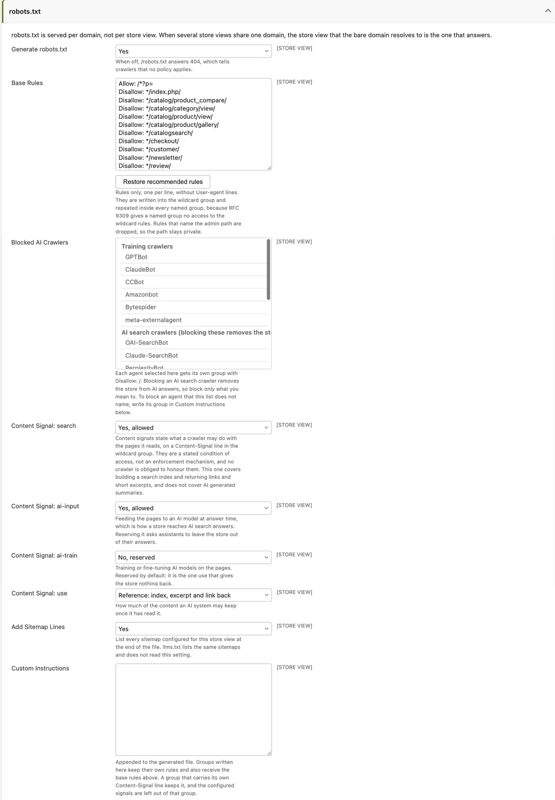
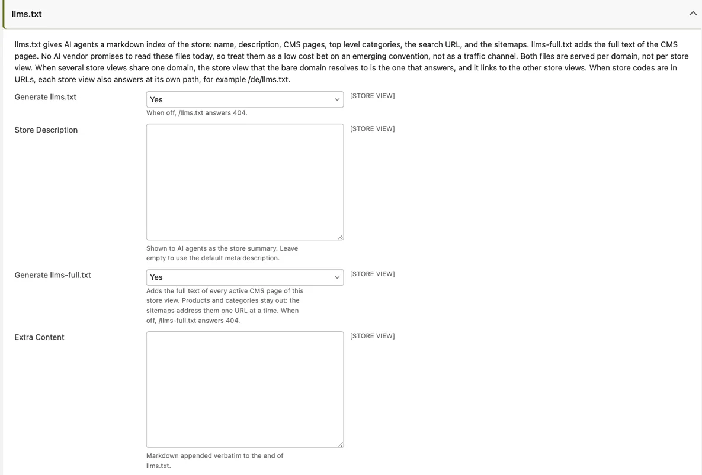

# AI Crawlers & llms.txt v26.9+

AI assistants and AI-powered search engines are becoming a real discovery channel for stores.
Maho gives you three tools to manage them, all served automatically and all configurable per
store view:

- **llms.txt** and **llms-full.txt** - a markdown index of your store, written for AI agents.
- **Content signals** in the generated robots.txt - a machine-readable statement of what
  crawlers may do with your content (search indexing, AI answers, AI training).
- **Markdown pages** - a markdown version of every product, category, CMS page and blog post,
  served on the same URL when an agent asks for it.

All three features are **enabled by default**, and a fresh or upgraded v26.9 store serves them
with no action on your part. This page explains what they contain, where every setting lives,
and how to change or disable each one.

!!! warning "Defaults changed on upgrade"
    After upgrading to v26.9, your generated robots.txt gains a `Content-Signal` line
    (`search=yes, ai-input=yes, ai-train=no, use=reference`) plus an explanatory notice, and
    your store starts answering at `/llms.txt` and `/llms-full.txt`, and your catalog, CMS and
    blog pages answer with markdown when a request asks for it. If that is not the policy you
    want, adjust the settings below. Flush the configuration cache after deploying so the new
    defaults apply.

## Where everything lives

All settings sit in **System > Configuration > Catalog > Crawlers & robots.txt**, in three
groups. Every field is configurable per store view.

| Group | Field | Default | What it does |
|---|---|---|---|
| robots.txt | Generate robots.txt | Yes | Serves a generated `/robots.txt`. When off, it answers 404. |
| robots.txt | Content Signal: search | Yes, allowed | Building a search index and returning links and short excerpts. Does not cover AI-generated summaries. |
| robots.txt | Content Signal: ai-input | Yes, allowed | Feeding pages to an AI model at answer time. This is how your store reaches AI search answers. |
| robots.txt | Content Signal: ai-train | No, reserved | Training or fine-tuning AI models on your pages. |
| robots.txt | Content Signal: use | Reference: index, excerpt and link back | How much of the content an AI system may keep once it has read it. |
| robots.txt | Blocked AI Crawlers | (none) | Each selected agent gets its own `Disallow: /` group. |
| robots.txt | Custom Instructions | (empty) | Extra robots.txt groups, appended to the generated file. |
| llms.txt | Generate llms.txt | Yes | Serves `/llms.txt`. When off, it answers 404. |
| llms.txt | Store Description | (empty) | The store summary shown to AI agents. Empty falls back to the default meta description. |
| llms.txt | Generate llms-full.txt | Yes | Serves `/llms-full.txt` with the full text of your CMS pages. When off, it answers 404. |
| llms.txt | Extra Content | (empty) | Markdown appended verbatim to the end of llms.txt. |
| Markdown for AI agents | Enabled | Yes | Serves the markdown version of a page on request. When off, every request gets HTML. |
| Markdown for AI agents | Routes | Catalog, CMS and blog pages | One route prefix per line, as `module/controller/action`. Only these pages get a markdown version. |
| Markdown for AI agents | Cache Lifetime | 3600 | Seconds a generated markdown page stays in the **Blocks HTML output** cache. `0` turns the cache off. |

Two settings outside this section also feed llms.txt:

| Setting | Location | Used for |
|---|---|---|
| Store Name | General > General > Store Information | The heading of llms.txt (falls back to the store group name, then the store view name). |
| Default Description | General > Design > HTML Head | The store summary, when the Store Description field above is empty. |

## Content signals in robots.txt

Content signals are a vocabulary from [contentsignals.org](https://contentsignals.org){:target="_blank"}
that lets a site state, inside robots.txt, what a crawler may do with the pages it reads. Maho
writes them as a `Content-Signal` line in the wildcard (`User-agent: *`) group of the
generated robots.txt.

The default policy is the one most merchants want:

- **search = yes** - stay in classic search indexes.
- **ai-input = yes** - stay visible in AI assistant answers and AI search. Reserving this asks
  assistants to leave your store out of their answers, which usually costs you traffic.
- **ai-train = no** - do not train AI models on your content. Training is the one use that
  gives the store nothing back, so it is reserved by default.
- **use = reference** - AI systems may index, excerpt and link back, but not keep and reuse
  the full content.

### What the signals mean legally

In plain words: the signals state your store's policy, they do not enforce it. They are a
stated condition of access, and no crawler is technically obliged to honour them. Whenever at
least one signal is stated, Maho also prints the standard notice from contentsignals.org at
the top of robots.txt. That notice declares that any restriction expressed through the signals
is an **express reservation of rights under Article 4 of EU Directive 2019/790** (the text and
data mining exception). This gives the reservation legal weight in the EU: a well-behaved AI
company that respects opt-outs has a clear, machine-readable statement to act on.

### Changing or silencing the signals

Each of the four signals has a **"Not stated"** option. A signal that is not stated is simply
left off the line: you neither grant nor restrict that use. Set **all four** signals to
"Not stated" to remove the `Content-Signal` line and the notice entirely, which restores the
robots.txt output you had before v26.9.

If you write your own group in **Custom Instructions** and give it its own `Content-Signal`
line, that group keeps its hand-written line and the configured signals stay out of it, so you
can state a different policy for a specific crawler.

!!! note "robots.txt generation"
    The generated robots.txt itself (base rules, blocked AI crawlers, sitemap lines) shipped in
    v26.9 as well. A `robots.txt` file you place in the `public/` directory is served by the
    web server directly and overrides everything configured in the admin; the admin page warns
    you when such a file exists. See the [robots.txt page](../hosting/robotstxt.md) for
    background on the file itself.

## llms.txt

`/llms.txt` is a proposed convention: a markdown file at the site root that gives AI agents a
compact, reliable index of the site instead of forcing them to crawl HTML.

Maho generates the file automatically with:

- The **store name** as the heading and the **store description** as a quote block.
- The store **locale** and **currency**, plus a note about the structured data your pages
  carry when the [Structured Data](structured-data.md) module is on.
- **Pages** - your active CMS pages (up to 100), excluding the home page, the 404 page and
  the cookie notice, plus a link to the blog when it has visible posts.
- **Categories** - your active top-level categories that are included in the menu (up to 50),
  each with its description on one line. Deeper categories are left to the sitemap.
- **Search** - the catalog search URL with a `QUERY` placeholder, so an agent can query your
  catalog directly.
- **API** - links to the REST API, GraphQL API and MCP server, but only for the protocols you
  have actually enabled. All are off by default, so a stock install lists none.
- **Sitemaps** - every XML sitemap configured for the store view. These are listed even when
  the robots.txt "Add Sitemap Lines" setting is off.
- **Other store views** - links to the llms.txt of your other active store views, with their
  locale, so an agent can find the right language version.
- Your **Extra Content** markdown, appended verbatim at the end.

Only content that is already public appears: active, store-visible CMS pages and active
categories. Products are deliberately left to the XML sitemaps, which address them one URL at
a time.

### llms-full.txt

`/llms-full.txt` serves the same header followed by the **full text of your CMS pages**,
converted to plain text, up to a cap of 512 KB. When the cap is reached the file says it is
truncated and points at the XML sitemap. It has its own on/off setting
(**Generate llms-full.txt**) and answers 404 when disabled.

### One file per domain

Both llms.txt and robots.txt are served **per domain, not per store view**. When several store
views share one domain, the store view that the bare domain resolves to is the one that
answers, and its llms.txt links to the other store views. When store codes are in URLs, each
store view also answers at its own path, for example `/de/llms.txt`.

### Set your expectations

No AI vendor promises to read llms.txt today, and Google has stated that it does not. Maho
ships it because the cost is near zero and the convention is emerging: treat it as a low-cost
bet, not as a traffic channel.

## Markdown for AI agents

An AI agent that reads a product page as HTML pays for the navigation, the scripts, the styles
and the tracking code before it reaches the product. Maho answers with markdown instead when the
agent asks for it. The URL stays the same, so browsers and search engines keep the HTML page.

An agent can ask in two ways:

- Send the header `Accept: text/markdown`. Agent clients such as Claude Code send it by default.
  Maho answers with markdown only when `text/markdown` outranks `text/html` in the header, so a
  browser never gets markdown by accident. A wildcard such as `*/*` never selects markdown.
- Append `.md` to the URL. `/women/` becomes `/women.md`, and `/lafayette-dress.html` becomes
  `/lafayette-dress.html.md`. The home page is `/index.md`.

Both forms answer the same document. A `.md` URL that redirects, for example to the canonical
URL of a product, keeps the suffix on the redirect target. A `.md` URL of a page without a
markdown version, such as the cart, answers `404` with a short markdown body.

Every HTML page that has a markdown version announces it with a `Link` header
(`rel="alternate"; type="text/markdown"`) and sends `Vary: Accept`. The markdown response carries
`X-Robots-Tag: noindex`, so search engines never index it as a duplicate. A CDN or a Varnish
cache in front of the store then keeps one copy of the page per `Accept` value. llms.txt mentions
the feature too, and its page and category links point straight to the markdown version.

### What the markdown contains

Each page is one document. Query parameters such as the page number, the sort order and the
layered navigation filters are ignored, so one URL names one document.

- **Product** - the name, the meta description, then SKU, price (with the regular price when a
  special price applies, or a price range for a bundle), availability, brand, GTIN, MPN, URL and
  up to ten image URLs. The description follows, then the same attributes as the "Additional
  Information" tab, then the options: one row per enabled child of a configurable product with
  the price the buyer pays and its availability, or one row per item of a grouped product.
- **Category** - the name, the meta description, the description, the CMS block of the landing
  page when the display mode shows one, the subcategories, and the first 100 products in
  position order as a table with a link, SKU, price and availability for each product. When the
  category holds more products, the table ends with a count of the remaining ones and points
  the agent to the XML sitemap.
- **CMS page** - the title, the meta description and the content converted to markdown, with
  template directives such as `{{media}}` and `{{widget}}` resolved.
- **Blog post** - the title, the meta description, the publish date, the image URL, the URL and
  the content converted to markdown.
- **Blog index** and **blog category** - one line per post with its date and an excerpt, for the
  first 100 posts.

Prices follow the display currency and the tax display setting of the store view, the same
rules as the structured data on the page.

### Search engines and duplicate content

A search engine never sees the markdown as a duplicate of the HTML page. Its crawler asks for
HTML, so the normal URL answers with HTML, and the `.md` URL answers with `X-Robots-Tag: noindex`,
which Google honors for any content type. A `noindex` page never enters the index. Do not add a
`Disallow: /*.md$` rule to robots.txt: a blocked URL can still be indexed from external links,
and the crawler cannot read the `noindex` header of a URL it may not fetch.

### Which pages answer

The **Routes** field lists the pages that get a markdown version, one route prefix per line.
The default covers the product page, the category page, CMS pages, the home page, blog posts and
the blog lists. Every other page, such as the cart, the checkout and the customer account, always
answers with HTML, whatever the request asks for. Remove a line to exclude a page.

A line alone does not add a page: the page also needs a renderer that builds its markdown. A
third-party module that ships one documents the route to add. Developers find the renderer
contract in the [Markdown renderers](../developer/markdown-renderers.md) guide.

### Web server

The Apache configuration that ships with Maho 26.9 lets `.md` URLs through. An nginx or Caddy
configuration written for an earlier version denies `.md` files, so every `.md` URL answers `404`
before the request reaches PHP. Remove `md` from the list of denied extensions, as the
[Web Server Configuration](../hosting/web-server.md) page shows. The `Accept` header works
without any web server change.

## Recommended setup

1. Open **System > Configuration > Catalog > Crawlers & robots.txt**.
2. Review the four **Content Signal** fields. Keep the defaults unless your policy differs;
   set all four to "Not stated" if you do not want to state any policy.
3. In the **llms.txt** group, write a short, factual **Store Description** (what you sell, who
   you serve, where you ship). Otherwise check that **General > Design > HTML Head > Default
   Description** is filled in, since it is the fallback.
4. Check **General > General > Store Information > Store Name**: it becomes the llms.txt
   heading.
5. Optionally add **Extra Content**: opening hours, shipping regions, a support contact, or
   anything an assistant should relay to shoppers.
6. Save, then flush the cache (see below), and open `/llms.txt`, `/llms-full.txt` and
   `/robots.txt` on your storefront to review the output.

## Caching

llms.txt and llms-full.txt are cached for one hour in the **Blocks HTML output** cache, one
copy per store view, and both files are sent with a `Cache-Control: public, max-age=3600`
header (robots.txt sends the same header). After changing settings, flush the
**Configuration** cache and the **Blocks HTML output** cache in System > Cache Management to
see the change immediately; otherwise it appears within the hour. Saving a CMS page or a
category also invalidates the cached files.

Markdown pages use the same **Blocks HTML output** cache, one copy per store view, currency,
customer group and URL, for the number of seconds in **Cache Lifetime**. A lifetime of `0`
turns the cache off, and every request builds the page again. Saving the product, the category,
the CMS page or the blog post clears its copy at once. A stock change or a catalog price rule
does not: the page updates when the lifetime ends. Set a shorter lifetime when stock changes
often, or flush the **Blocks HTML output** cache after a bulk import.
